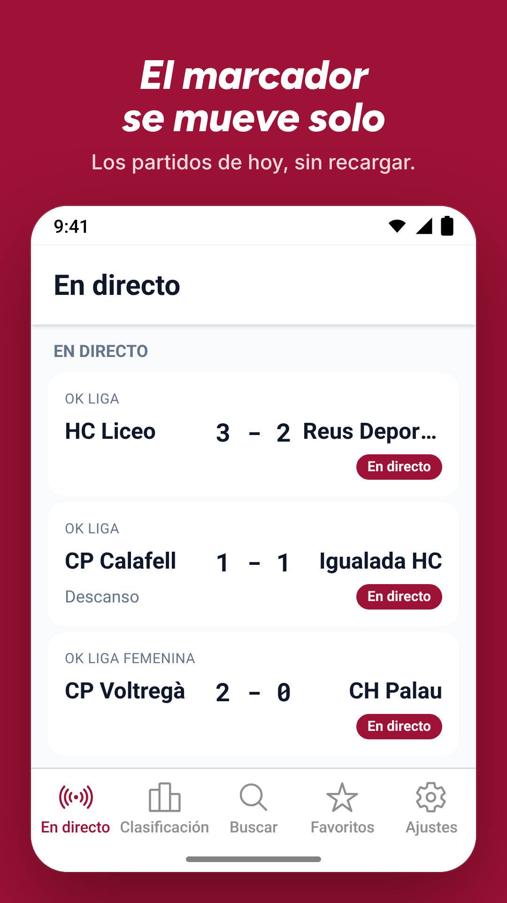
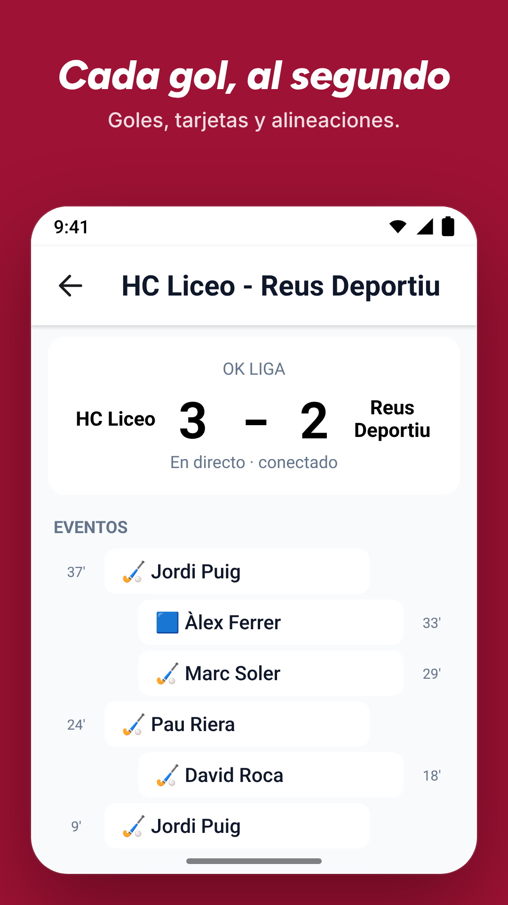
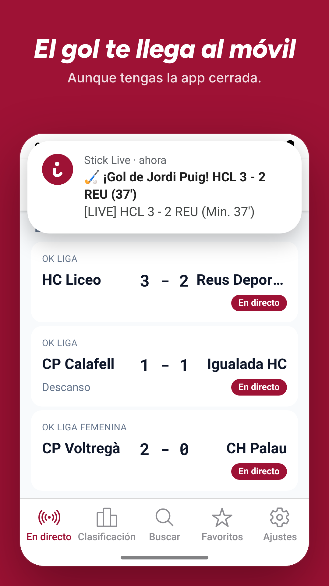
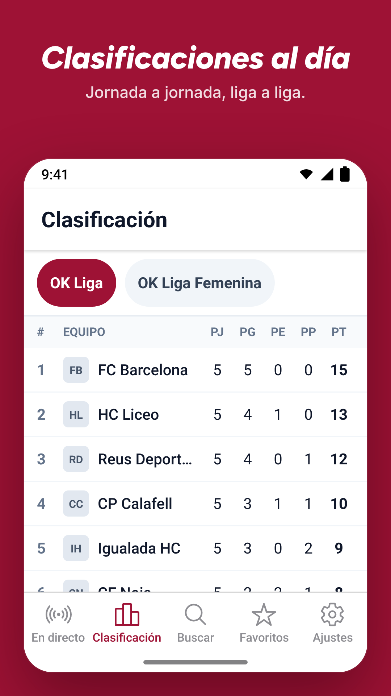
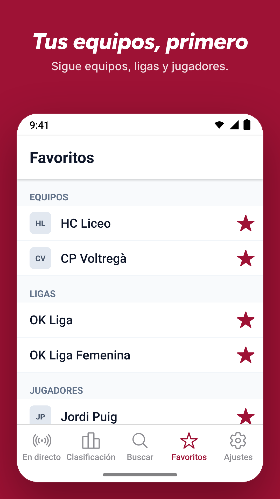
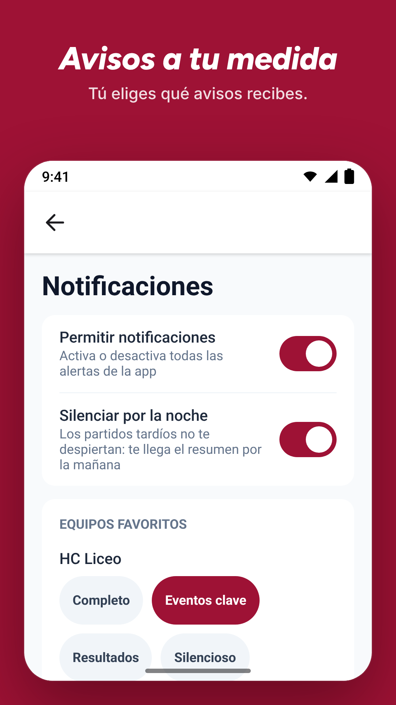

<div align="center">


# Stick Live

**Risultati di hockey su pista (rink hockey) in diretto**: scraper → ETL → PostgreSQL → API con SSE → web PWA e app Android. Un progetto reale, con oltre 100 migrazioni di database, cinque mesi in produzione (giugno → novembre 2026) e oggi rilasciato come **codice open source (MIT)**.

Lingue: [Español](README.md) · [Português](README.pt.md) · **Italiano**

</div>

[](https://github.com/angelrobledano/sticklive/actions/workflows/ci.yml)
[](LICENSE)


> **⚠️ Stato del progetto: CHIUSO (novembre 2026).** Il servizio `sticklive.eu` è offline e non è previsto riaprirla. Il codice resta qui libero per chi voglia usarlo, farne un fork o prenderlo come riferimento. I motivi, qui sotto: [Perché il progetto è stato chiuso?](#perché-il-progetto-è-stato-chiuso)

---

## Cos'è?

Stick Live era una piattaforma per seguire l'hockey su pista in diretto in stile FotMob o Sofascore: punteggi che si aggiornano da soli, scheda partita con formazioni ed eventi, classifiche, preferiti sincronizzati sul cloud e notifiche push per squadra, lega o giocatore. Tutto alimentato da scraping autonomo delle fonti ufficiali e da un ETL che normalizza e risolve le entità (club, sezioni, alias) prima di scrivere su PostgreSQL.

I dati provenivano dalla **FEP (via SIDGAD)** e dalla **World Skate Europe**, con uno storico pluriennale (catalogo RFEP 1999/00 → 2025/26: ~9 600 partite con classifiche).

## Screenshot

Prodotto reale, non mockup (screenshot dell'app Android pubblicata su Google Play):

| In diretto — il punteggio si muove da solo | Scheda partita — goal, carte ed eventi minuto per minuto |
|:---:|:---:|
|  |  |
| **Push del goal** anche con l'app chiusa | **Classifiche** sempre aggiornate, lega per lega |
|  |  |
| **Preferiti**: squadre, leghe e giocatori | **Notifiche su misura**: silenzio notturno e modalità per squadra |
|  |  |

### Cosa vale la pena guardare nel codice (quello che forse cerchi)

- **Diretto vero via SSE**: l'ETL scrive sul DB → trigger `NOTIFY` → l'API aggiorna per partita e fa fan-out ai client SSE, con riconnessione automatica e polling di riserva sul web.
- **Push veri, non giocattolo**: Web Push (VAPID) sul web e Expo Push → FCM su Android, con preferenze per squadra/lega/giocatore, raggruppamento intelligente e silenzio notturno. Dettagli: [docs/NOTIFICACIONES.md](docs/NOTIFICACIONES.md) (spagnolo).
- **Entity Resolution fatta bene**: identità del club separata dalle sezioni e dai nomi degli sponsor; risoluzione deterministica + fuzzy con coda di revisione umana. [docs/RUNBOOK_ENTITY_RESOLUTION.md](docs/RUNBOOK_ENTITY_RESOLUTION.md) (spagnolo).
- **Eventi con identità derivata dal contenuto** (non posizionale): gli upsert sono idempotenti per `source_ref` e `match_events` è una tabella partizionata.
- **i18n in 5 lingue** con URL per lingua, hreflang, sitemap dinamico, metadata per scheda, schema.org e immagini Open Graph dinamiche per partita.
- **Resilienza dell'uscita configurabile** verso la fonte (diretta / Cloudflare Worker / seconda IP) con backoff esponenziale, jitter e circuit breaker. [docs/egress-sidgad.md](docs/egress-sidgad.md) (spagnolo).
- **CI bloccante**: typecheck, lint senza warning, test unitari + di integrazione su Postgres 16 reale, `npm audit --omit=dev`, migrazioni da zero e build dell'immagine di produzione.

## Perché il progetto è stato chiuso?

Lo dico chiaro, perché è la cosa onesta e perché può risparmiare a qualcuno lo stesso viaggio.

1. **Aveva una dipendenza impossibile da sostituire.** I dati arrivavano dalle fonti ufficiali: la RFEP (via SIDGAD) e la World Skate Europe. Senza licenza né fonte alternativa, il prodotto era una facciata bellissima sopra un contratto inesistente.
2. **A novembre 2026 la RFEP ha pubblicato un avviso riservandosi espressamente i diritti di riutilizzo dei propri dati** (database, referti ufficiali, fotografie, stemmi) **e senza autorizzare l'estrazione automatizzata** da parte di terzi.
3. **Il quadro europeo lascia pochi dubbi.** Il diritto *sui generis* sulle banche dati (Direttiva 96/9/CE; artt. 132 e seguenti del TRLPI spagnolo) tutela l'investimento di chi raccoglie e verifica quei dati, e un'estrazione sistematica giorno dopo giorno, stagione dopo stagione, è esattamente il caso contemplato.
4. **Le opzioni reali erano due**: negoziare una licenza federativa — senza ricavi che la sostenessero né un team alle spalle — oppure assumersi un rischio legale crescente per un progetto personale. Nessuna delle due era ragionevole, quindi **ho chiuso il servizio prima che avesse conseguenze**.

In sintesi: non ha chiuso per mancanza di utenti né di tecnica; ha chiuso per qualcosa di molto più semplice — **i dati non erano miei e il titolare non voleva cederli**. Lezione imparata: se il tuo prodotto dipende da dati di terzi, l'autorizzazione a usarli è una decisione di prodotto, non un dettaglio tecnico.

## E perché allora il codice è open source?

Perché il lavoro è fatto e i dati, che erano il problema, **non sono mai stati nel repository**: qui non c'è una sola riga del database né dump di alcuna fonte, solo codice.

- Se costruisci qualcosa di simile, qui trovi quasi un anno di decisioni prese e di motivazioni documentate: diretto via SSE, entity resolution, modelli di competizione con fasi, push segmentati… [docs/architecture.md](docs/architecture.md) (spagnolo).
- Se sei una federazione, un club o un'azienda di media, puoi usare questa base come punto di partenza con **le tue fonti autorizzate**.
- Se vuoi solo leggere come si monta un monorepo Turborepo vero, con oltre cento migrazioni e una CI bloccante, tutto è qui.

## Architettura

```text
Fonti (sidgad/FEP + World Skate Europe)
        │  scraper: Playwright + Cheerio, API interne di sidgad
        ▼
   apps/scraper          estrazione
        │
        ▼
   apps/etl              normalizzazione, risoluzione delle entità,
        │                upsert idempotenti, cron e emitter di push
        ▼
   PostgreSQL (packages/db)   105 migrazioni versionate
        │
        ▼
   apps/api  (Hono)      REST + SSE del diretto, auth, push  :3000
        │
        ├── apps/mobile (Expo SDK 57, Android)  la STESSA API (REST + SSE)
        ▼
   apps/web  (Next.js 16, App Router)  mobile-first, PWA, i18n ×5  :3001
        │
        ▼
      Utente            Caddy (HTTPS) davanti in produzione
```

## Struttura del repository

```text
apps/
  scraper/   Scraper (FEP e World Skate, su sidgad)
  etl/       Caricamento su DB, cron del diretto, emitter di push
  api/       API Hono (REST + SSE + auth + admin + push + pagamenti)
  web/       Frontend Next.js (App Router, i18n proprio, PWA)
  mobile/    App Android con Expo (SDK 57): docs/app.md
packages/
  db/        Client pg + migrazioni SQL + query
  shared-types/   Tipi TS condivisi
  analytics/ PostHog lato server
  logger/    Logging condiviso
deploy/      Dockerfile di produzione, Caddyfile, scheduler, backup/restore
infra/docker/ Compose di sviluppo (PostgreSQL)
scripts/     Packaging build-server.mjs e verifica dell'immagine
tests/integration/  Test di integrazione su Postgres reale
docs/        Documentazione (indice sotto)
```

## Avvia in sviluppo

Requisiti: **Node ≥ 20** (la CI usa 22) e **Docker** per PostgreSQL 16.

```bash
# 1. PostgreSQL
docker compose -f infra/docker/docker-compose.yml \
               -f infra/docker/docker-compose.dev.yml up -d postgres

# 2. Installare e configurare
npm install
cp .env.example .env          # DATABASE_URL punta a localhost:5432

# 3. Migrazioni (runner idempotente)
npm run db:migrate

# 4. Tutto il monorepo in sviluppo (turbo): api :3000, web :3001, scraper
npm run dev
```

| Comando | Cosa fa |
|---|---|
| `npm run dev` | Turbo dev (api, web, scraper) |
| `npm run build` | Build di tutti i workspace |
| `npm run typecheck` | TypeScript in tutto il monorepo |
| `npm run lint` | ESLint (bloccante in CI) |
| `npm run test` | Test unitari |
| `npm run test:integration:docker` | Test di integrazione su Postgres reale |
| `npm run db:migrate` | Applica le migrazioni di `packages/db/migrations` |
| `npm run scraper:run -- --run-once <scraper>` | Esegue uno scraper una volta |
| `npm run etl:run` | Esegue l'ETL (pipeline/cron) |

> **Importante**: senza dati delle fonti vedrai la piattaforma vuota dopo l'avvio. Lo scraper è accoppiato alle strutture di SIDGAD (FEP e World Skate Europe) e **ottenere quei dati senza l'autorizzazione dei titolari è responsabilità tua, non di questo repository**. Puoi puntare lo scraper a un'altra fonte adattando `apps/scraper`.

## Dati, fonti e avvisi

- **Questo repository non include dati**: né referti, né storici, né dump. Solo codice.
- I dati che il prodotto serviva provenivano dalla **Reale Federazione Spagnola di Pattinaggio** (via SIDGAD) e dalla **World Skate Europe**; i titolari sono loro e **questo progetto non ha alcun rapporto ufficiale con loro**. Se pensi di usare i loro dati, parla con i titolari e rispetta le loro condizioni.
- Il nome **Stick Live**, il logo e i testi appartengono all'autore. Marchi, nomi e stemmi di club e competizioni appartengono ai rispettivi titolari.

## Documentazione

La documentazione tecnica di riferimento è in spagnolo (in `docs/`):

| Documento | Contenuto |
|---|---|
| [docs/ESTADO_PROYECTO.md](docs/ESTADO_PROYECTO.md) | Tutto ciò che funzionava, da un capo all'altro, alla chiusura |
| [docs/architecture.md](docs/architecture.md) | Architettura, flusso di dati, entità, decisioni |
| [docs/pipeline-datos.md](docs/pipeline-datos.md) | Scraper ed ETL: fonti, parsing, dedup, entity resolution |
| [docs/egress-sidgad.md](docs/egress-sidgad.md) | Uscita verso la fonte: rotte, resilienza e runbook |
| [docs/database.md](docs/database.md) | Architettura dei dati, tabelle, constraint, migrazioni |
| [docs/api.md](docs/api.md) | Endpoint REST/SSE |
| [docs/DEPLOY.md](docs/DEPLOY.md) | Deploy con Docker Compose e Caddy |
| [docs/operations.md](docs/operations.md) | Operazioni: cron, log, alert, recovery |
| [docs/dr.md](docs/dr.md) | Disaster recovery |
| [docs/RUNBOOK_COMPETICIONES.md](docs/RUNBOOK_COMPETICIONES.md) | Gestione delle competizioni |
| [docs/NOTIFICACIONES.md](docs/NOTIFICACIONES.md) | Quando e come vengono inviati i push |
| [docs/TRACKING_POSTHOG.md](docs/TRACKING_POSTHOG.md) | Cosa si misurava e dove guardarlo |
| [docs/app.md](docs/app.md) | App Android (Expo): sessione, push, EAS, release |
| [docs/CHANGELOG.md](docs/CHANGELOG.md) | Storia delle tappe |

## Licenza

[MIT](LICENSE). Fai quello che vuoi col codice; per i dati ricorda che i titolari sono le federazioni: usa fonti che hai diritto di usare.

## Autore

**Ángel Robledano** — [github.com/angelrobledano](https://github.com/angelrobledano). Sviluppato tra giugno e novembre 2026 come progetto personale e indipendente.
