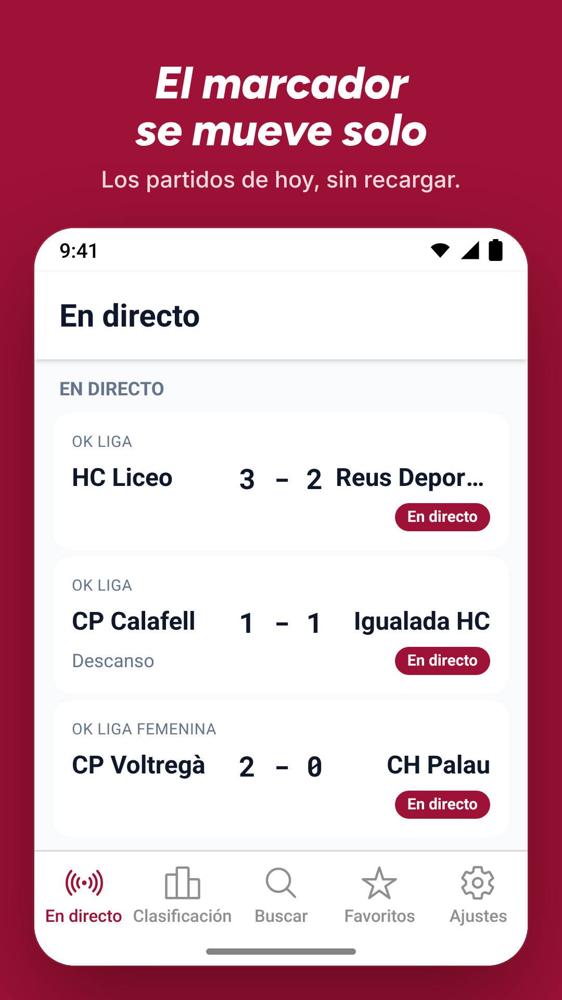
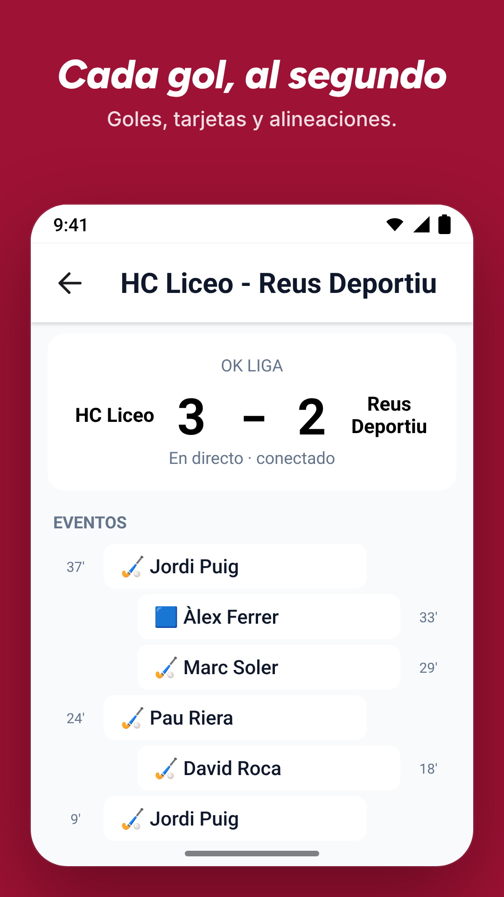
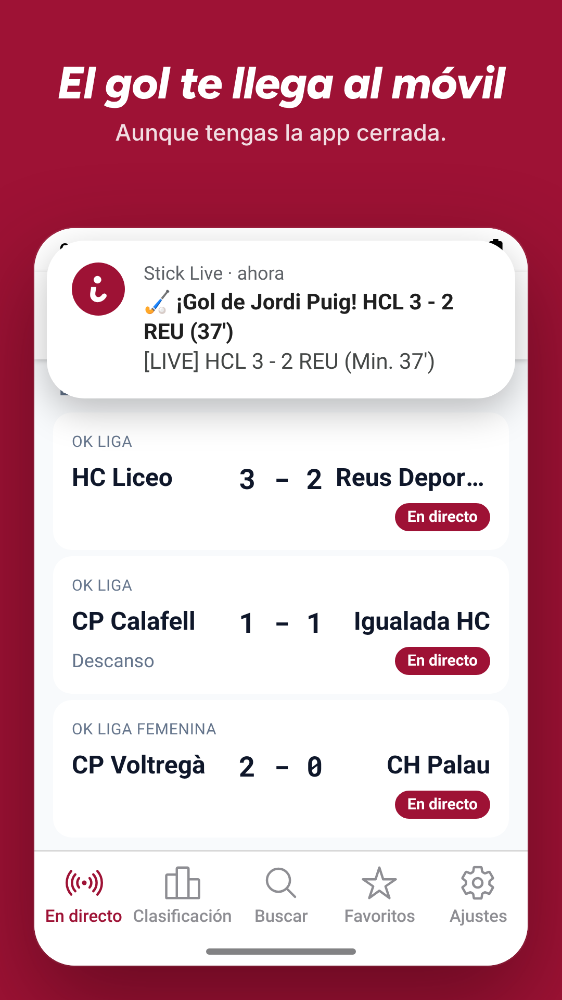
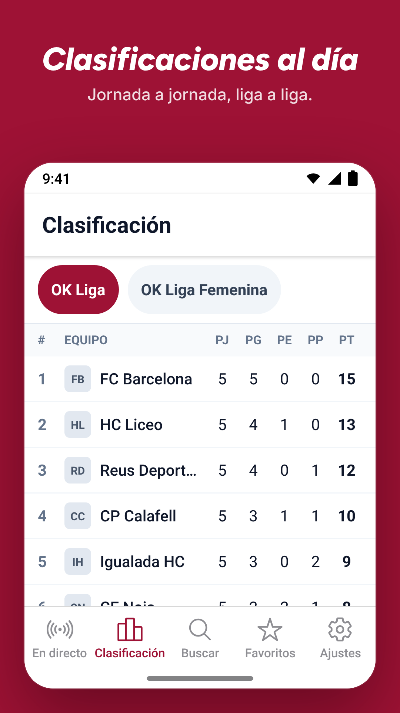
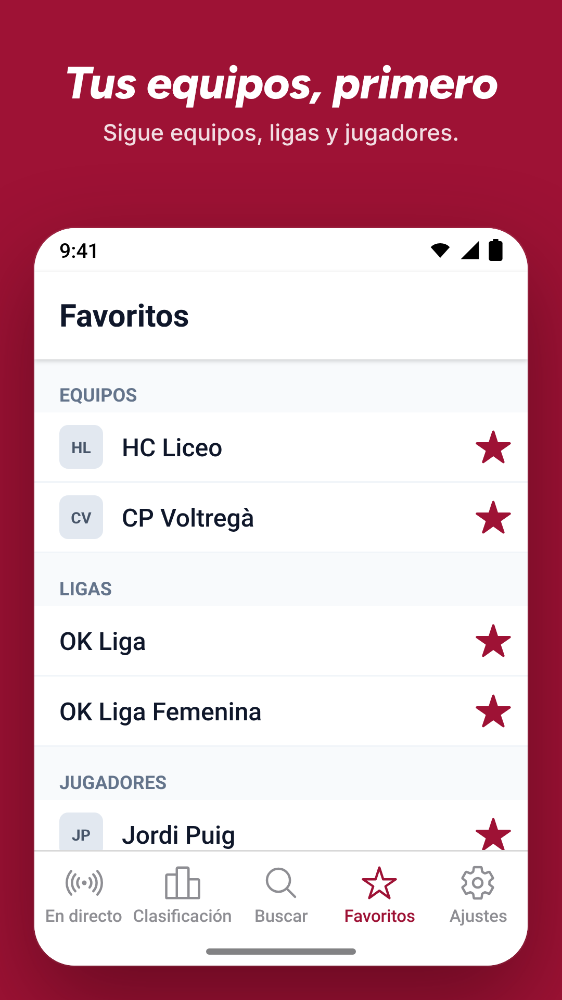
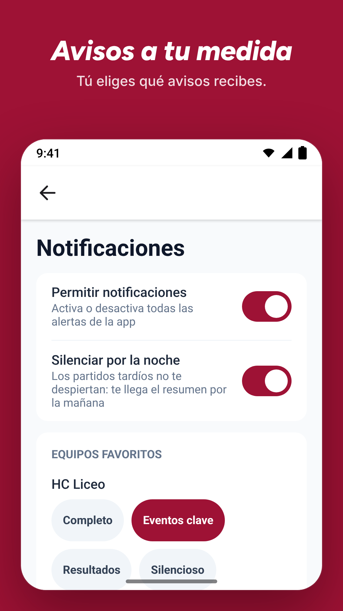

<div align="center">


# Stick Live

**Resultados de hockey sobre patines (rink hockey) en directo**: scraper → ETL → PostgreSQL → API con SSE → web PWA y app Android. Un proyecto real, con más de 100 migraciones de base de datos, cinco meses en producción (junio → noviembre de 2026) y hoy liberado como **código open source (MIT)**.

Idiomas: **Español** · [Português](README.pt.md) · [Italiano](README.it.md)

</div>

[](https://github.com/angelrobledano/sticklive/actions/workflows/ci.yml)
[](LICENSE)


> **⚠️ Estado del proyecto: CERRADO (noviembre de 2026).** El servicio `sticklive.eu` está fuera de línea y no está previsto retomarlo. El código queda aquí libre para quien quiera usarlo, forkarlo o tomarlo como referencia. El porqué, abajo: [¿Por qué se cerró?](#por-qué-se-cerró-el-proyecto)

---

## ¿Qué es?

Stick Live era una plataforma para seguir el hockey sobre patines en directo al estilo de FotMob o Sofascore: marcadores que se actualizan solos, ficha de partido con alineaciones y eventos, clasificaciones, favoritos sincronizados en la nube y avisos push por equipo, liga o jugador. Todo alimentado por scraping propio de las fuentes oficiales y un ETL que normaliza y resuelve entidades (clubes, secciones, alias) antes de escribir en PostgreSQL.

Obtenía los datos de **la FEP (vía SIDGAD)** y de **World Skate Europe**, con histórico multi-temporada (catálogo RFEP 1999/00 → 2025/26: ~9 600 partidos con clasificaciones).

## Capturas

Capturas reales de la app Android del proyecto (la app no llegó a publicarse en Google Play, pero el producto era este):

| En directo — el marcador se mueve solo | Ficha de partido — goles, tarjetas y eventos al minuto |
|:---:|:---:|
|  |  |
| **Push de gol** aunque tengas la app cerrada | **Clasificaciones** al día, liga a liga |
|  |  |
| **Favoritos**: equipos, ligas y jugadores | **Avisos a medida**: silencio nocturno y modo por equipo |
|  |  |

### Destacables del código (lo que quizá vengas a buscar)

- **Directo de verdad por SSE**: el ETL escribe en la BD → triggers `NOTIFY` → la API refresca por partido y hace fan-out a los clientes SSE, con reconexión automática y polling de respaldo en la web.
- **Push reales, no de juguete**: Web Push (VAPID) en web y Expo Push → FCM en Android, con preferencias por equipo/liga/jugador, agrupado inteligente y silencio nocturno. Detalle: [docs/NOTIFICACIONES.md](docs/NOTIFICACIONES.md).
- **Entity Resolution bien hecho**: identidad de club separada de secciones y nombres de patrocinio; resolución determinista + fuzzy con cola de revisión humana. [docs/RUNBOOK_ENTITY_RESOLUTION.md](docs/RUNBOOK_ENTITY_RESOLUTION.md).
- **Eventos con identidad derivada del contenido** (no posicional): los upserts son idempotentes por `source_ref` y `match_events` es una tabla particionada.
- **i18n a 5 idiomas** con URLs por idioma, hreflang, sitemap dinámico, metadata por ficha, schema.org e imágenes Open Graph dinámicas por partido.
- **Resiliencia de salida configurable** hacia la fuente (directa / Cloudflare Worker / segunda IP) con backoff exponencial, jitter y circuit breaker. [docs/egress-sidgad.md](docs/egress-sidgad.md).
- **CI bloqueante**: typecheck, lint a cero avisos, tests unitarios + de integración contra Postgres 16 real, `npm audit --omit=dev`, migraciones desde cero y build de la imagen de producción.

## ¿Por qué se cerró el proyecto?

Lo digo claro, porque es lo honesto y porque a alguien le puede ahorrar el mismo viaje.

1. **Tenía una dependencia imposible de sustituir.** Los datos venían de las fuentes oficiales: la RFEP (vía SIDGAD) y World Skate Europe. Sin licencia ni fuente alternativa, el producto era una fachada bonita sobre un contrato que no existía.
2. **En noviembre de 2026 la RFEP publicó un aviso reservándose expresamente los derechos de reutilización de sus datos** (bases de datos, actas oficiales, fotografías, escudos) **y sin autorizar la extracción automatizada** por terceros.
3. **El marco europeo deja pocas dudas.** El derecho *sui generis* sobre bases de datos (Directiva 96/9/CE; arts. 132 y siguientes del TRLPI en España) ampara la inversión de quien recoge y verifica esos datos, y una extracción sistemática día tras día, temporada tras temporada, es exactamente el caso contemplado.
4. **Las opciones reales eran dos**: negociar una licencia federativa — sin ingresos que la sostengan ni equipo detrás — o asumir un riesgo jurídico creciente para un proyecto personal. Ninguna era razonable, así que **cerré el servicio antes de que tuviera consecuencias**.

En resumen: no se cerró por falta de usuarios ni de técnica; se cerró por algo mucho más sencillo — **los datos no eran míos y su titular no quería cederlos**. Lección aprendida: si tu producto depende de datos de terceros, el permiso para usarlos es decisión de producto, no un detalle técnico.

## ¿Por qué entonces el código es open source?

Porque el trabajo está hecho y los datos, que era lo problemático, **nunca estuvieron en el repo**: aquí no hay ni una fila de la base de datos ni dumps de ninguna fuente, solo código.

- Si construyes algo parecido, aquí hay casi un año de decisiones tomadas y porqués documentados: directo por SSE, entity resolution, modelos de competiciones con fases, push segmentados… [docs/architecture.md](docs/architecture.md).
- Si eres una federación, club o medio, puedes usar esta base como punto de partida con **tus propias fuentes autorizadas**.
- - Si solo quieres leer cómo se monta un monorepo Turborepo de verdad, con más de cien migraciones y un CI bloqueante, todo eso está aquí.

## Arquitectura

```text
Fuentes (sidgad/FEP + World Skate Europe)
        │  scraper: Playwright + Cheerio, APIs internas de sidgad
        ▼
   apps/scraper          extracción
        │
        ▼
   apps/etl              normalización, resolución de entidades,
        │                upserts idempotentes, crons y emisor de push
        ▼
   PostgreSQL (packages/db)   105 migraciones versionadas
        │
        ▼
   apps/api  (Hono)      REST + SSE del directo, auth, push  :3000
        │
        ├── apps/mobile (Expo SDK 57, Android)  la MISMA API (REST + SSE)
        ▼
   apps/web  (Next.js 16, App Router)  mobile-first, PWA, i18n ×5  :3001
        │
        ▼
      Usuario            Caddy (HTTPS) delante en producción
```

## Estructura del repositorio

```text
apps/
  scraper/   Scrapers (FEP y World Skate, sobre sidgad)
  etl/       Carga a BD, crons de directo, emisor de push
  api/       API Hono (REST + SSE + auth + admin + push + pagos)
  web/       Frontend Next.js (App Router, i18n propio, PWA)
  mobile/    App Android con Expo (SDK 57): docs/app.md
packages/
  db/        Cliente pg + migraciones SQL + queries
  shared-types/   Tipos TS compartidos
  analytics/ PostHog en servidor
  logger/    Logging compartido
deploy/      Dockerfile de producción, Caddyfile, scheduler, backup/restore
infra/docker/ Compose de desarrollo (PostgreSQL)
scripts/     Empaquetado build-server.mjs y verificación de imagen
tests/integration/  Tests de integración contra Postgres real
docs/        Documentación (índice abajo)
```

## Arranca en desarrollo

Requisitos: **Node ≥ 20** (CI usa 22) y **Docker** para PostgreSQL 16.

```bash
# 1. PostgreSQL
docker compose -f infra/docker/docker-compose.yml \
               -f infra/docker/docker-compose.dev.yml up -d postgres

# 2. Instalar y configurar
npm install
cp .env.example .env          # DATABASE_URL apunta a localhost:5432

# 3. Migraciones (runner idempotente)
npm run db:migrate

# 4. Todo el monorepo en desarrollo (turbo): api :3000, web :3001, scraper
npm run dev
```

| Comando | Qué hace |
|---|---|
| `npm run dev` | Turbo dev (api, web, scraper) |
| `npm run build` | Build de todos los workspaces |
| `npm run typecheck` | TypeScript en todo el monorepo |
| `npm run lint` | ESLint (bloqueante en CI) |
| `npm run test` | Tests unitarios |
| `npm run test:integration:docker` | Tests de integración contra Postgres real |
| `npm run db:migrate` | Aplica las migraciones de `packages/db/migrations` |
| `npm run scraper:run -- --run-once <scraper>` | Ejecuta un scraper una vez |
| `npm run etl:run` | Ejecuta el ETL (pipeline/crons) |

> **Importante**: sin datos de las fuentes, tras arrancar verás la plataforma vacía. El scraper está acoplado a las estructuras de SIDGAD (FEP y World Skate Europe) y **obtener esos datos sin autorización de sus titulares es responsabilidad tuya, no de este repo**. Puedes apuntar el scraper a otra fuente adaptando `apps/scraper`.

## Datos, fuentes y avisos

- **Este repositorio no incluye datos**: ni actas, ni históricos, ni dumps. Solo código.
- Los datos que servía el producto venían de que venía de la **Real Federación Española de Patinaje** (vía SIDGAD) y de **World Skate Europe**; sus titulares son ellos y **este proyecto no les está afiliado ni tiene ninguna relación oficial**. Si piensas usar sus datos, habla con sus titulares y cumple sus condiciones.
- El nombre **Stick Live**, el logo y los textos son del autor. Marcas, nombres y escudos de clubes y competiciones pertenecen a sus respectivos titulares.

## Documentación

La documentación técnica de referencia (en español):

| Documento | Contenido |
|---|---|
| [docs/ESTADO_PROYECTO.md](docs/ESTADO_PROYECTO.md) | Qué funcionaba, de punta a punta, al cerrar |
| [docs/architecture.md](docs/architecture.md) | Arquitectura, flujo de datos, entidades, decisiones |
| [docs/pipeline-datos.md](docs/pipeline-datos.md) | Scrapers y ETL: fuentes, parsing, dedup, entity resolution |
| [docs/egress-sidgad.md](docs/egress-sidgad.md) | Salida hacia la fuente: rutas, resiliencia y runbook |
| [docs/database.md](docs/database.md) | Arquitectura de datos, tablas, constraints, migraciones |
| [docs/api.md](docs/api.md) | Endpoints REST/SSE |
| [docs/DEPLOY.md](docs/DEPLOY.md) | Despliegue con Docker Compose y Caddy |
| [docs/operations.md](docs/operations.md) | Operación: crons, logs, alertas, recuperación |
| [docs/dr.md](docs/dr.md) | Disaster recovery |
| [docs/RUNBOOK_COMPETICIONES.md](docs/RUNBOOK_COMPETICIONES.md) | Gestión de competiciones |
| [docs/NOTIFICACIONES.md](docs/NOTIFICACIONES.md) | Cuándo y cómo se envían los push |
| [docs/TRACKING_POSTHOG.md](docs/TRACKING_POSTHOG.md) | Qué se medía y dónde verlo |
| [docs/app.md](docs/app.md) | App Android (Expo): sesión, push, EAS, release |
| [docs/CHANGELOG.md](docs/CHANGELOG.md) | Historial de hitos |

## Licencia

[MIT](LICENSE). Haz lo que quieras con el código; en cuanto a datos, recuerda que sus titulares son las federaciones: usa fuentes que tengas derecho a usar.

## Autor

**Ángel Robledano** — [github.com/angelrobledano](https://github.com/angelrobledano). Desarrollado entre junio y noviembre de 2026 como proyecto personal e independiente.
