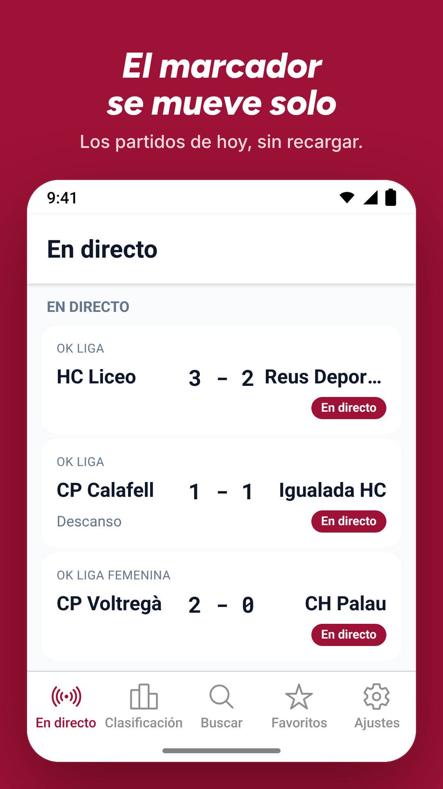
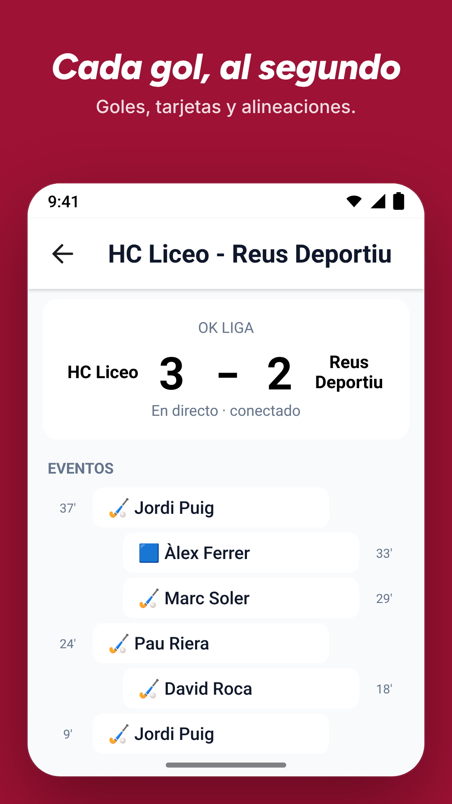
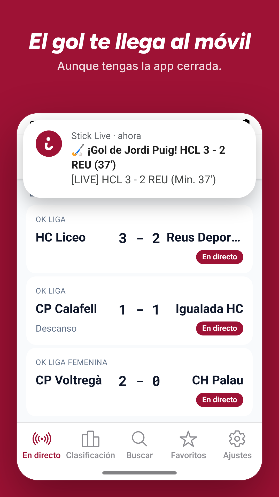
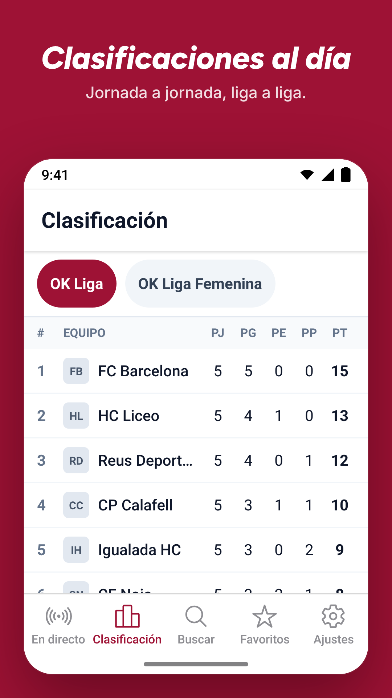
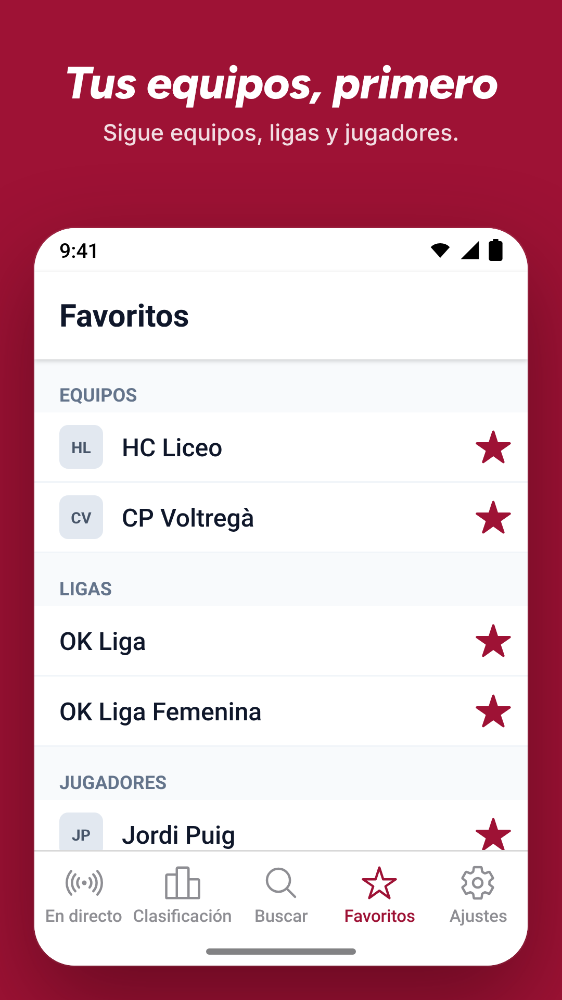
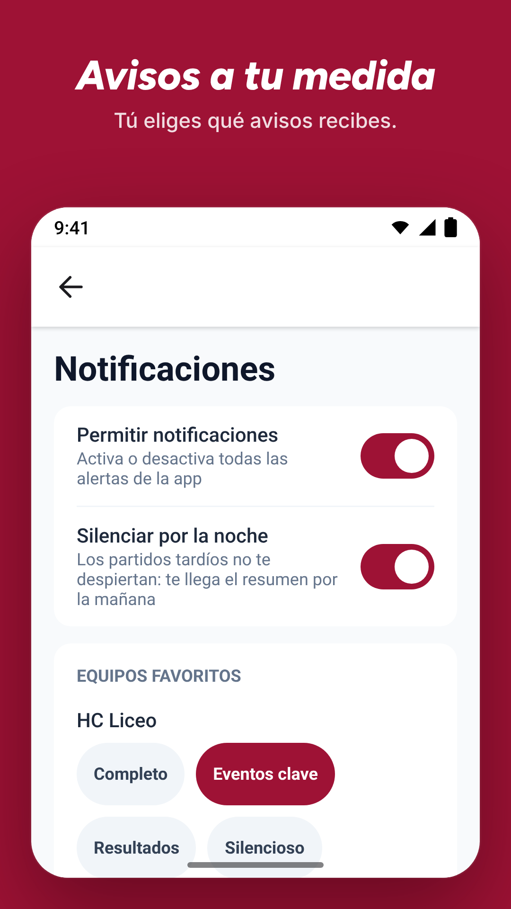

<div align="center">


# Stick Live

**Resultados de hóquei em patins (rink hockey) em direto**: scraper → ETL → PostgreSQL → API com SSE → web PWA e app Android. Um projeto real, com mais de 100 migrações de base de dados, cinco meses em produção (junho → novembro de 2026) e hoje disponibilizado como **código open source (MIT)**.

Idiomas: [Español](README.md) · **Português** · [Italiano](README.it.md)

</div>

[](https://github.com/angelrobledano/sticklive/actions/workflows/ci.yml)
[](LICENSE)


> **⚠️ Estado do projeto: ENCERRADO (novembro de 2026).** O serviço `sticklive.eu` está offline e não está previsto retomá-lo. O código fica aqui livre para quem quiser usá-lo, fazer fork ou usar como referência. Os motivos, abaixo: [Porquê o encerramento?](#porquê-o-projeto-foi-encerrado)

---

## O que é?

O Stick Live era uma plataforma para acompanhar o hóquei em patins em direto no estilo do FotMob ou do Sofascore: marcadores que se atualizam sozinhos, ficha de jogo com alinhamentos e eventos, classificações, favoritos sincronizados na nuvem e alertas push por equipa, liga ou jogador. Tudo alimentado por scraping próprio das fontes oficiais e um ETL que normaliza e resolve entidades (clubes, secções, alcunhas) antes de escrever no PostgreSQL.

Os dados vinham da **FEP (via SIDGAD)** e da **World Skate Europe**, com histórico de várias temporadas (catálogo RFEP 1999/00 → 2025/26: ~9 600 jogos com classificações).

## Capturas de ecrã

Produto real, não mockups (capturas da app Android publicada na Google Play):

| Em direto — o marcador mexe-se sozinho | Ficha de jogo — golos, cartões e eventos minuto a minuto |
|:---:|:---:|
|  |  |
| **Push de golo** mesmo com a app fechada | **Classificações** actualizadas, liga a liga |
|  |  |
| **Favoritos**: equipas, ligas e jogadores | **Alertas à medida**: silêncio noturno e modo por equipa |
|  |  |

### O que há de interessante no código (o que talvez venhas procurar)

- **Direto a sério via SSE**: o ETL escreve na BD → triggers `NOTIFY` → a API refresca por jogo e faz fan-out para os clientes SSE, com reconexão automática e polling de reserva na web.
- **Push reais, não de brincar**: Web Push (VAPID) na web e Expo Push → FCM no Android, com preferências por equipa/liga/jogador, agrupamento inteligente e silêncio noturno. Detalhes: [docs/NOTIFICACIONES.md](docs/NOTIFICACIONES.md) (espanhol).
- **Entity Resolution bem feito**: identidade do clube separada das secções e dos nomes de patrocínio; resolução determinista + fuzzy com fila de revisão humana. [docs/RUNBOOK_ENTITY_RESOLUTION.md](docs/RUNBOOK_ENTITY_RESOLUTION.md) (espanhol).
- **Eventos com identidade derivada do conteúdo** (não posicional): os upserts são idempotentes por `source_ref` e `match_events` é uma tabela particionada.
- **i18n em 5 idiomas** com URLs por idioma, hreflang, sitemap dinâmico, metadata por ficha, schema.org e imagens Open Graph dinâmicas por jogo.
- **Resiliência de saída configurável** para a fonte (directa / Cloudflare Worker / segunda IP) com backoff exponencial, jitter e circuit breaker. [docs/egress-sidgad.md](docs/egress-sidgad.md) (espanhol).
- **CI bloqueante**: typecheck, lint sem avisos, testes unitários + de integração contra Postgres 16 real, `npm audit --omit=dev`, migrações desde zero e build da imagem de produção.

## Porquê o projeto foi encerrado?

Digo-o com clareza, porque é o honesto e porque pode poupar a alguém a mesma viagem.

1. **Tinha uma dependência impossível de substituir.** Os dados vinham das fontes oficiais: a RFEP (via SIDGAD) e a World Skate Europe. Sem licença nem fonte alternativa, o produto era uma fachada bonita sobre um contrato que não existia.
2. **Em novembro de 2026 a RFEP publicou um aviso reservando expressamente os direitos de reutilização dos seus dados** (bases de dados, súmulas oficiais, fotografias, emblemas) **e sem autorizar a extração automatizada** por terceiros.
3. **O quadro europeu deixa poucas dúvidas.** O direito *sui generis* sobre bases de dados (Directiva 96/9/CE; arts. 132 e seguintes do TRLPI em Espanha) protege o investimento de quem recolhe e verifica esses dados, e uma extração sistemática dia após dia, temporada após temporada, é precisamente o caso previsto.
4. **As opções reais eram duas**: negociar uma licença federativa — sem receitas que a sustentassem nem equipa atrás — ou assumir um risco jurídico crescente num projeto pessoal. Nenhuma era razoável, por isso **fechei o serviço antes que tivesse consequências**.

Em resumo: não fechou por falta de utilizadores nem de técnica; fechou por algo muito mais simples — **os dados não eram meus e o titular não queria cedê-los**. Lição aprendida: se o teu produto depende de dados de terceiros, a autorização para os usar é uma decisão de produto, não um detalhe técnico.

## E porque é que o código é open source?

Porque o trabalho está feito e os dados, que era o problema, **nunca estiveram no repositório**: aqui não há uma única linha da base de dados nem dumps de qualquer fonte, só código.

- Se vais construir algo parecido, aqui há quase um ano de decisões tomadas e porquês documentados: direto via SSE, entity resolution, modelos de competições com fases, push segmentados… [docs/architecture.md](docs/architecture.md) (espanhol).
- Se és uma federação, clube ou comunicação social, podes usar esta base como ponto de partida com **as tuas próprias fontes autorizadas**.
- Se só queres ler como se monta um monorepo Turborepo a sério, com mais de cem migrações e um CI bloqueante, tudo isso está aqui.

## Arquitetura

```text
Fontes (sidgad/FEP + World Skate Europe)
        │  scraper: Playwright + Cheerio, APIs internas de sidgad
        ▼
   apps/scraper          extração
        │
        ▼
   apps/etl              normalização, resolução de entidades,
        │                upserts idempotentes, crons e emissor de push
        ▼
   PostgreSQL (packages/db)   105 migrações versionadas
        │
        ▼
   apps/api  (Hono)      REST + SSE do direto, auth, push  :3000
        │
        ├── apps/mobile (Expo SDK 57, Android)  a MESMA API (REST + SSE)
        ▼
   apps/web  (Next.js 16, App Router)  mobile-first, PWA, i18n ×5  :3001
        │
        ▼
      Utilizador            Caddy (HTTPS) à frente em produção
```

## Estrutura do repositório

```text
apps/
  scraper/   Scrapers (FEP e World Skate, sobre sidgad)
  etl/       Carga para a BD, crons do direto, emissor de push
  api/       API Hono (REST + SSE + auth + admin + push + pagamentos)
  web/       Frontend Next.js (App Router, i18n próprio, PWA)
  mobile/    App Android com Expo (SDK 57): docs/app.md
packages/
  db/        Cliente pg + migrações SQL + queries
  shared-types/   Tipos TS partilhados
  analytics/ PostHog no servidor
  logger/    Logging partilhado
deploy/      Dockerfile de produção, Caddyfile, scheduler, backup/restore
infra/docker/ Compose de desenvolvimento (PostgreSQL)
scripts/     Empacotamento build-server.mjs e verificação de imagem
tests/integration/  Testes de integração contra Postgres real
docs/        Documentação (índice abaixo)
```

## Arranca em desenvolvimento

Requisitos: **Node ≥ 20** (o CI usa 22) e **Docker** para PostgreSQL 16.

```bash
# 1. PostgreSQL
docker compose -f infra/docker/docker-compose.yml \
               -f infra/docker/docker-compose.dev.yml up -d postgres

# 2. Instalar e configurar
npm install
cp .env.example .env          # DATABASE_URL aponta para localhost:5432

# 3. Migrações (runner idempotente)
npm run db:migrate

# 4. Todo o monorepo em desenvolvimento (turbo): api :3000, web :3001, scraper
npm run dev
```

| Comando | O que faz |
|---|---|
| `npm run dev` | Turbo dev (api, web, scraper) |
| `npm run build` | Build de todos os workspaces |
| `npm run typecheck` | TypeScript em todo o monorepo |
| `npm run lint` | ESLint (bloqueante no CI) |
| `npm run test` | Testes unitários |
| `npm run test:integration:docker` | Testes de integração contra Postgres real |
| `npm run db:migrate` | Aplica as migrações de `packages/db/migrations` |
| `npm run scraper:run -- --run-once <scraper>` | Executa um scraper uma vez |
| `npm run etl:run` | Executa o ETL (pipeline/crons) |

> **Importante**: sem dados das fontes, verás a plataforma vazia após arrancar. O scraper está acoplado às estruturas do SIDGAD (FEP e World Skate Europe) e **obter esses dados sem autorização dos seus titulares é responsabilidade tua, não deste repositório**. Podes apontar o scraper para outra fonte adaptando `apps/scraper`.

## Dados, fontes e avisos

- **Este repositório não inclui dados**: nem súmulas, nem históricos, nem dumps. Só código.
- Os dados que o produto servia vinham da **Real Federação Espanhola de Patinagem** (via SIDGAD) e da **World Skate Europe**; os titulares são eles e **este projeto não tem qualquer relação oficial com eles**. Se pensas usar os seus dados, fala com os titulares e cumpre as suas condições.
- O nome **Stick Live**, o logótipo e os textos pertencem ao autor. Marcas, nomes e emblemas de clubes e competições pertencem aos respectivos titulares.

## Documentação

A documentação técnica de referência está em espanhol (na raiz de `docs/`):

| Documento | Conteúdo |
|---|---|
| [docs/ESTADO_PROYECTO.md](docs/ESTADO_PROYECTO.md) | O que funcionava, de ponta a ponta, ao fechar |
| [docs/architecture.md](docs/architecture.md) | Arquitetura, fluxo de dados, entidades, decisões |
| [docs/pipeline-datos.md](docs/pipeline-datos.md) | Scrapers e ETL: fontes, parsing, dedup, entity resolution |
| [docs/egress-sidgad.md](docs/egress-sidgad.md) | Saída para a fonte: rotas, resiliência e runbook |
| [docs/database.md](docs/database.md) | Arquitetura de dados, tabelas, constraints, migrações |
| [docs/api.md](docs/api.md) | Endpoints REST/SSE |
| [docs/DEPLOY.md](docs/DEPLOY.md) | Deploy com Docker Compose e Caddy |
| [docs/operations.md](docs/operations.md) | Operação: crons, logs, alertas, recuperação |
| [docs/dr.md](docs/dr.md) | Disaster recovery |
| [docs/RUNBOOK_COMPETICIONES.md](docs/RUNBOOK_COMPETICIONES.md) | Gestão de competições |
| [docs/NOTIFICACIONES.md](docs/NOTIFICACIONES.md) | Quando e como são enviados os push |
| [docs/TRACKING_POSTHOG.md](docs/TRACKING_POSTHOG.md) | O que se media e onde ver |
| [docs/app.md](docs/app.md) | App Android (Expo): sessão, push, EAS, release |
| [docs/CHANGELOG.md](docs/CHANGELOG.md) | Histórico de marcos |

## Licença

[MIT](LICENSE). Faz o que quiseres com o código; quanto aos dados, recorda que os titulares são as federações: usa fontes que tenhas o direito de usar.

## Autor

**Ángel Robledano** — [github.com/angelrobledano](https://github.com/angelrobledano). Desenvolvido entre junho e novembro de 2026 como projeto pessoal e independente.
