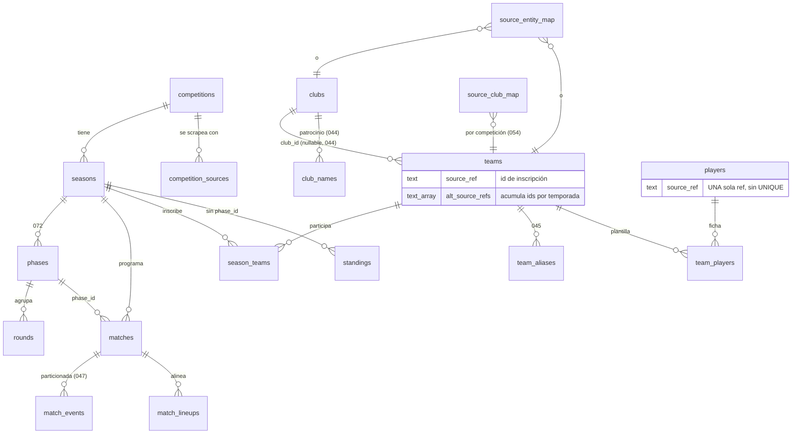
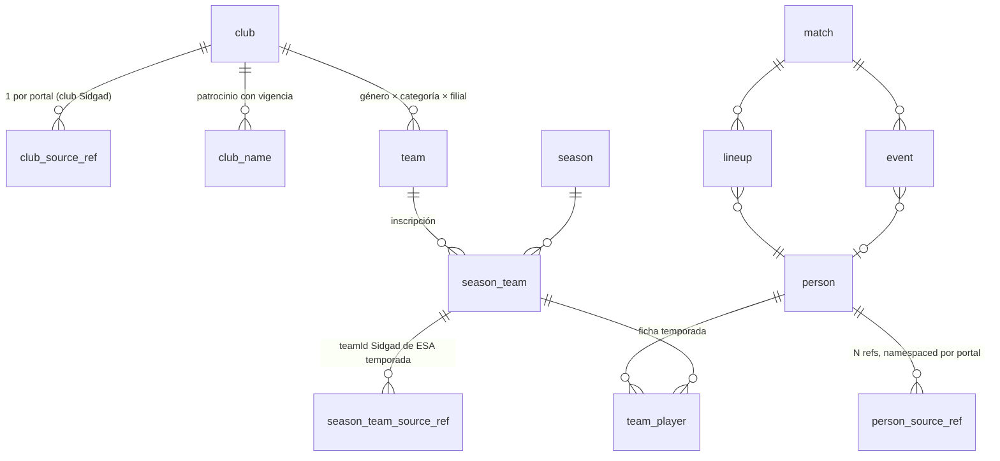

# OKMob frente a Stick Live: modelo de datos, identidad y scraping

**Fecha:** 22/10/2026
**Alcance:** diagnóstico y propuesta. No se ha modificado código, esquema, migraciones ni datos.
**Fuentes de evidencia:**

1. Estudio previo `docs/investigacion-okmob/` (01–09 + README, 21/10/2026) y sus cuerpos crudos en `.tmp-okmob/bodies/` (no versionados).
2. Comportamiento observable de OKMob: `push.okmob.app/comps`, `profiles.json`, `standings.json`, `calendar.json`, `rules.json`, `live.okmob.app/ref/person-xwalk.json`, `live/board.json` (consultado de nuevo el 22/10) y bundle `live/x`.
3. Repositorio Stick Live en `main` (`684528f`, 20/10/2026). El repo local va 37 commits por delante, pero todos son de `apps/mobile`: backend, migraciones, scraper y ETL son idénticos.
4. API pública de producción `https://sticklive.eu/api` (solo lectura, 22/10/2026, ~200 peticiones).

**Niveles de confianza:** **V** verificado (leído en código, respuesta HTTP o datos de producción) · **I** inferencia razonable a partir de varias evidencias · **H** hipótesis pendiente de validar.

---

## 1. Resumen ejecutivo

La respuesta corta a "¿dónde está nuestra principal limitación?" es: **en la resolución de entidades, y más concretamente en cómo nombramos los identificadores de la fuente**. No está en las fuentes (OKMob y Stick Live leen exactamente la misma plataforma Sidgad), no está principalmente en el scraping (nuestros parsers extraen más detalle que OKMob) y el modelo relacional es en general mejor que el suyo. Lo que falla es que tratamos IDs que solo son únicos dentro de un portal Sidgad como si fueran globales, y que la capa de club que diseñamos en agosto existe en el esquema pero no está viva.

Cinco conclusiones, por orden de gravedad:

1. **Hay corrupción de identidad de jugadores en producción (V).** El parser de actas genera `fep_player_{id}` para cualquier portal (RFEP, FECAPA y World Skate), y el alta de jugador busca por esa ref. Como cada portal numera a sus jugadores por separado, dos personas distintas acaban en la misma fila. En una muestra de 168 jugadores de competiciones World Skate, **17 (10 %) tienen carreras imposibles**: Pol Galbas Pedrol (OK Liga, Caldes y Sant Cugat) aparece además jugando el Mundial Sub-19 con Italia y el Mundial Femenino con Colombia. Marc Vázquez Compte (Cerdanyola, Girona) aparece en el Mundial con Suiza. El estudio previo no lo detectó.
2. **Los jugadores catalanes están duplicados y desconectados de su historial (V).** Al dar de alta la Lliga Catalana (FECAPA), Martí Serra Molist, Biel Pujadas, Carles Domènech o Miquel Escala tienen dos fichas: la RFEP con su carrera en OK Liga y una nueva de FECAPA con solo la Lliga Catalana, con un token "OKL" pegado al apellido y la foto de otra persona (ID de FECAPA consultado en el CDN de RFEP).
3. **La identidad de club no funciona en la práctica (V).** `clubs` se rellenó una sola vez (108 clubes = 108 equipos, 1:1, el 03/08) y nada crea clubes desde entonces. Calafell aparece como cinco equipos sin relación entre sí (`CALAFELL LA MENORQUINA`, `PARLEM CALAFELL`, `CLUB PATI CALAFELL TOT L'ANY`, `CP CALAFELL TOT L'ANY`, `CALAFELL TOT L'ANY`), cuatro de ellos sin club, género ni categoría. Su historia en OK Liga está repartida en cuatro fichas.
4. **OKMob no resuelve la identidad mejor "en general": resuelve mejor un caso concreto (I/V).** Usa el ID de club de Sidgad (el número o slug del fichero de escudo, `logos_clubes/322.png`) como clave estable de club, el ID de jugador de cada portal como clave de persona dentro de ese portal, y un crosswalk curado de solo 1.004 personas para el cruce entre portales, con pares prohibidos y redirecciones. Es un sistema modesto pero correctamente acotado. Nosotros tenemos piezas más sofisticadas (cola HITL, alias, redirecciones) colgadas de claves equivocadas.
5. **En competiciones y directo Stick Live va por delante en estructura (V).** El modelo `Competition → Season → Phase → Round → Match` (migración 072) es más expresivo que el de OKMob, que es plano y se apoya en títulos y regex. Lo que OKMob tiene y nosotros no es reglamento como datos (zonas de ascenso, descenso, play-off con cascadas) y una cobertura de base mucho mayor (159 competiciones FECAPA, 110 vigentes, frente a 20 competiciones nuestras).

**Recomendación principal:** antes de dar de alta ninguna competición más de FECAPA, World Skate u otro portal autonómico, introducir el espacio de nombres por portal en las refs de jugador (y de partido/competición) y reparar los jugadores fusionados. Después, activar la capa de club usando el ID de club de Sidgad como clave. Todo lo demás (crosswalk entre portales, reglamento, cobertura) depende de esas dos cosas.

---

## 2. Evaluación del estudio previo

El estudio de 21/10 es serio en método (niveles A–D, muestra declarada, redacción de datos personales) y acierta en lo esencial sobre la arquitectura de OKMob. Pero contrastado con los cuerpos crudos y con nuestros datos, tiene tres huecos que cambian las prioridades.

### 2.1 Conclusiones que se sostienen

| Afirmación del estudio | Contraste | Estado |
|---|---|---|
| OKMob y Stick Live leen la misma plataforma Sidgad | URLs de escudos, `idc`/`idp`, portales | V |
| Prefijos implícitos por federación (`R`, `W`, `I`, FECAPA numérico) y colisión `idc=260` | `comps`, calendarios | V |
| `person-xwalk`: 1.004 personas, 855 (85,2 %) en más de una federación, 108 en las tres | Recontado: 747 en dos, 108 en tres, 149 en una | V |
| 56 correspondencias de club entre federaciones | `comps.clubs` | V |
| El acta OKMob es incompleta frente a la oficial (4 eventos) | Muestra de 1 acta | V para la muestra |
| OKMob es CSR, sin SSR real | HTML idéntico en rutas profundas | V |
| Stick Live no tiene `yellow_card` en `match_events` | CHECK de 047 | V (impacto bajo: en la muestra solo afecta al banquillo) |

### 2.2 Lo que el estudio interpretó mal o no vio

**El crosswalk no es una capa de identidad completa, es una lista de excepciones.** Tiene 1.004 personas, mientras que solo el catálogo FECAPA vigente agrupa 2.005 IDs de inscripción de equipo y miles de jugadores. Además de `persons`, contiene `forbid` (5 pares de IDs declarados como personas distintas) y `moved` (2 redirecciones de clave tras fusionar). Es decir, una tabla de correspondencias curada, con restricciones negativas y redirecciones. Esa estructura es lo verdaderamente copiable, no "la identidad de jugador" como bloque.

**World Skate no da IDs de jugador estables.** 217 de las 1.004 personas tienen más de un ID World Skate (Carles Domènech: `W4272` y `W7619`). FECAPA (8) y RFEP (2) son casi estables. Esto importa para Stick Live: dentro de RFEP y FECAPA el ID de la fuente basta como clave de persona, en World Skate no.

**El `teamId` de Sidgad no es un ID de equipo, es un ID de inscripción.** En `comps` hay 2.371 `teamId` distintos para 310 claves de escudo. Sant Cugat tiene 60 `teamId`, Palau 50, Voltregà 49. El estudio lo describe como "ID de la fuente" del equipo, y de ahí deduce que OKMob tiene "identidad por competición". Lo correcto es que **Sidgad tiene tres niveles de ID** y OKMob usa el estable (club) para agregar.

**La clave de club de OKMob es el ID del escudo.** Las correspondencias son del tipo `rfep:calafell ↔ fecapa:322` o `rfep:fcbarcelona ↔ fecapa:234`. `calafell` y `fcbarcelona` son nombres de fichero de `rfep/images/logos_clubes/`, y `322`/`234` los de `fecapa/images/logos_clubes/`. El perfil de jugador devuelve `clubLogo: .../logos_clubes/322.png`. En el directo FISR, `HOCKEY BASSANO A` y `HOCKEY BASSANO B` comparten `logos_clubes/4003.png`. (I, alta confianza: patrón consistente en las 56 correspondencias y en los 310 grupos.)

**El estudio afirma que Stick Live tiene `players.source_ref` "por fuente".** No es así: todas las actas Sidgad producen `fep_player_{id}` (`apps/scraper/src/scrapers/fep/fep-ficha.parser.ts:235, 313, 793`). El estudio prioriza el crosswalk de jugadores como P1 "para igualar a OKMob", cuando el problema real es P0: estamos fusionando personas distintas ahora mismo.

**El perfil de OKMob es por temporada.** `profiles.json?...&temps=41` devuelve `profiles: {"41": {...}}` con secciones por competición y grupos por fase dentro de esa temporada. La continuidad entre temporadas no se verificó y puede que la interfaz la construya pidiendo varias temporadas. No hay evidencia de una entidad persona global salvo el crosswalk.

### 2.3 Incógnitas del estudio que afectan a decisiones de Stick Live

Solo tres de las catorce incógnitas del estudio cambian lo que debemos hacer: la precisión del crosswalk (decide si vale la pena un crosswalk curado o basta con el ID de portal), si los 56 mapeos de club son exhaustivos (decide cuánto HITL requerirá agrupar clubes) y si World Skate reasigna IDs por competición (decide la regla de identidad para selecciones). Las demás (rate limits de `/chat`, purga de caché, `/debug`) son relevantes para OKMob, no para nosotros.

---

## 3. Qué hace especialmente bien OKMob

Ordenado por relevancia para nuestro modelo, no por vistosidad.

1. **Elige la clave estable correcta para agrupar clubes**: el ID de club de Sidgad, que sobrevive a cambios de patrocinador y de inscripción. Con eso, filiales, femenino y base del mismo club se agrupan sin heurística de nombre.
2. **Separa identidad de fuente y presentación**: `fx` para el partido, `av` para la versión del acta, `pv` para el pabellón, crosswalk para personas.
3. **Gestiona el cruce entre portales como un problema acotado y curado**, con restricciones negativas (`forbid`) y redirecciones (`moved`).
4. **Reglamento como datos**: `rules.json` v7, 43 reglas en 2025/26 y 23 en 2026/27, con zonas (`campio`, `ascens`, `playoff-ascens`, `playout`, `descens`, `fase-final`, `placement`), cascadas por número de ascensos y cita de la norma.
5. **Cobertura de base**: 159 competiciones FECAPA (Prebenjamí 22, Benjamí 21, Aleví 8, Infantil 7, Femení 11–19…), 37 RFEP, 17 World Skate, y FISR en el directo.
6. **Señales de frescura en el directo**: cada acta caliente lleva versión `v`, número de eventos `ev`, firma `evSig`, `stale` y faltas `fo`. El cliente sabe si lo que ve está desactualizado.

Lo que OKMob hace peor y no debemos copiar: contratos sin IDs de equipo en calendario y clasificación, números como strings, reglas enlazadas por regex sobre el nombre de la competición, zonas calculadas solo en cliente, perfiles que identifican la competición por nombre (`competitionRaw`) y no por `idc`, CSR sin SEO.

---

## 4. Qué hace Stick Live hoy

### 4.1 Modelo real (migraciones 001–080)



### 4.2 Lo que funciona bien (y no hay que tocar)

- **Identidad de jugador dentro de RFEP (V).** `fep_player_4095` (Martí Serra) agrega Liceo 2022/23 y Calafell 2025/26. `fep_player_4646` (Marc Grau) agrega cuatro temporadas y tres competiciones. El ID de jugador del portal es estable entre temporadas y clubes, y lo usamos bien.
- **Estructura de competición (V).** `phases` con `kind` (`league`/`groups`/`knockout`), `is_placement`, `resolved_by`, `rounds.stage` canónico y `matches.series_game`. Cubre liga + play-off, grupos + final four, eliminatorias a varios partidos y puestos de consolación sin un campo genérico de tipo. La Lliga Catalana (grupos + semifinal + final) se modeló bien.
- **Integridad (V).** FK `NOT NULL` en `matches`, sin `ON DELETE CASCADE`, `entity_redirects` con trigger de borrado, `data_quality` como interruptor, `import_batches` para reversibilidad.
- **Directo (V).** Estado del partido "lo que dice la fuente" (`resolveStatusTransition`), refs de evento derivadas del contenido con desambiguación (`disambiguateEventRefs`, #375), prefijo de evento por fuente (`wse_event_`), `source_club_map` para el desajuste club/equipo del feed `rfep_mc_1.php`, watchdog de partidos atascados en `live`.
- **Embudo de ER de equipos (V).** `RefResolver.resolveTeam`: `source_entity_map` → `source_ref`/`alt_source_refs` → slug → `team_aliases` → fuzzy con bloqueo → cola HITL, sin auto-confirmar a ciegas.

### 4.3 Lo que falla

Se detalla en las secciones 5 a 8. En síntesis: los IDs no llevan espacio de nombres de portal, el equipo se ancla en el ID de inscripción (inestable) en vez de en el de club (estable), la capa `clubs` está congelada en un backfill 1:1, el jugador solo admite una ref, las clasificaciones no se ligan a la fase y no hay reglamento como datos.

---

## 5. Clubes, equipos y jugadores

### 5.1 Los tres niveles de ID de Sidgad

Este es el hallazgo que ordena todo lo demás.

| Nivel | Ejemplo | Estabilidad | Quién lo usa |
|---|---|---|---|
| **Club** | `logos_clubes/322.png` (FECAPA), `logos_clubes/calafell.png` y clase `club_69` (RFEP) | Estable entre temporadas, competiciones, categorías y patrocinadores dentro de un portal | OKMob para agregar clubes. Stick Live solo en `source_club_map` (por competición) y en `fep_club_*` del directo |
| **Inscripción de equipo** | `teamId` 3690 (Calafell en Supercopa 26/27), 3408 (Igualada OK Liga 25/26) | Cambia por temporada y por competición (2.371 IDs para 310 clubes) | Stick Live como `teams.source_ref`, acumulando las siguientes en `alt_source_refs` |
| **Jugador** | `id_player` 4095 (RFEP), 14782 (FECAPA), 3801 (WS) | Estable dentro de RFEP y FECAPA, inestable en World Skate | Ambos, pero Stick Live sin espacio de nombres |

Stick Live usa como clave del equipo el nivel menos estable y deja sin usar el más estable. La consecuencia la documentó el propio equipo en `project_volcado_historico` (12/08): el re-scrape de 2023/24 trajo refs 26xx–27xx frente a 3xxx del volcado, generó una "lluvia de Ref no resuelto → HITL" y duplicó equipos y partidos. Y `ref-collisions.ts` (#228) reconoce que la misma ref `1450` designa a C.E. NOIA y a CH CASTELLAR.

### 5.2 Clubes y equipos: caso Calafell (V)

| Equipo en Stick Live | Club | Género/cat. | Temporadas |
|---|---|---|---|
| CALAFELL LA MENORQUINA | `calafell-la-menorquina` (1:1) | male/senior | 2025/26 y 2026/27: OK Liga, Copa del Rey, Supercopa, Lliga Catalana |
| PARLEM CALAFELL | null | null | 2022/23, 2023/24 OK Liga + Histórico |
| CLUB PATI CALAFELL TOT L'ANY | null | null | 2019/20 OK Liga + Histórico |
| CP CALAFELL TOT L'ANY | null | null | Histórico OK Liga |
| CALAFELL TOT L'ANY | null | null | Histórico Copa Princesa |

Cuatro de las cinco filas usan el mismo escudo `rfep/images/logos_clubes/calafell.png`. OKMob las agruparía por esa clave. Nuestro `team_aliases` y el fuzzy no las unen porque los nombres comerciales difieren ("Parlem", "Tot l'Any", "La Menorquina") y `normalize()` solo quita patrocinadores registrados en `sponsors`.

El informe interno de 19/10 (`docs/INFORME_EQUIPOS_2026-10-19.md`) cuenta 346 equipos, 214 sin género o categoría, y 7 grupos de clubes candidatos a duplicado por nombre exacto. El caso Calafell muestra que el problema es mayor que esos 7 grupos: los duplicados por cambio de patrocinador no comparten nombre normalizado y no aparecen en esa consulta.

**Qué pertenece al club y qué al equipo.** De OKMob y de nuestro propio diseño (`ARQUITECTURA_ENTITY_RESOLUTION.md` §3) se deduce lo mismo: el club posee escudo, ciudad, nombre deportivo, historial de nombres comerciales y la clave Sidgad de club. El equipo (club × género × categoría × nivel de filial) posee plantilla, clasificaciones, racha e historial de competición. La inscripción (equipo × temporada × competición) posee el `teamId` de Sidgad, el grupo y el nombre comercial de esa temporada. El modelo de 044 ya separa club y equipo, pero no tiene el tercer nivel: `season_teams` existe y es la inscripción, pero no guarda la ref de la fuente, que sigue en `teams.alt_source_refs` como array global.

### 5.3 Jugadores

#### Caso 1: fusión de personas distintas (V)

`players.source_ref` no tiene restricción de unicidad por portal y el parser emite `fep_player_{id}` para todas las actas Sidgad. `upsertPlayerByRef` (`fep-ficha.scraper.ts:337`) busca `WHERE source_ref = $1` y, si encuentra fila, la reutiliza. El equipo lo detectó en el Mundial de octubre para las fotos (`docs/audit-wsg-asu26.md` §H.3, `player-photo-url.ts`) y lo corrigió solo en la resolución de foto.

Barrido de 168 jugadores que aparecen en las estadísticas de las cuatro competiciones World Skate de producción. 17 tienen una carrera imposible:

| Ref | Ficha | Carrera que muestra la API |
|---|---|---|
| `fep_player_4716` | POL GALBAS PEDROL | OK Liga (Caldes, Sant Cugat), OK Liga Plata Sur (Noia B, Espanyol) **y** Mundial Sub-19 con Italia **y** Mundial Femenino con Colombia |
| `fep_player_3907` | MARC VÁZQUEZ COMPTE | OK Liga (Cerdanyola, Girona) **y** Mundial con Suiza |
| `fep_player_4720` | FERRAN LOPEZ JURADO | OK Liga (Parlem Calafell) **y** Mundial Sub-19 con Italia **y** Mundial Femenino con Colombia |
| `fep_player_192` | MARC GRAU TALLADA | Mundial con España **y** con Argentina |
| `fep_player_520` | DAVIDE GAVIOLI | Mundial con Italia **y** con Chile |
| `fep_player_2316` | LUCAS MARTINEZ | Mundial con Argentina **y** con Francia |

Además de la colisión RFEP↔World Skate, aparecen pertenencias cruzadas entre el Mundial Femenino y el Sub-19 masculino dentro del propio World Skate (8 casos con el patrón Italia/Colombia). La causa exacta de ese segundo patrón no está verificada (H): puede ser reutilización de IDs entre ediciones del portal, que encaja con los 217 IDs múltiples de World Skate en el crosswalk de OKMob, o una pertenencia `team_players` mal resuelta. Se valida con la consulta V2 de la sección 12.

Consecuencias actuales: estadísticas de jugador contaminadas, fichas de jugador indexables con datos falsos, notificaciones push de "jugador favorito" que se disparan por goles de otra persona, y una fusión que la detección de `ref-collisions.ts` no puede ver porque no hay dos filas que comparar.

#### Caso 2: misma persona partida en dos fichas (V)

| Persona | Ficha RFEP | Ficha FECAPA | Crosswalk OKMob |
|---|---|---|---|
| Martí Serra Molist | `fep_player_4095`, OK Liga Liceo y Calafell | "MARTÍ **OKL** SERRA MOLIST", foto `rfep/fichas/14782.jpg` | `fecapa 14782 ↔ rfep R4095 ↔ ws W3801` |
| Biel Pujadas Colomer | foto `rfep/fichas/13827_1.jpg` | "BIEL **OKL** PUJADAS COLOMER", foto `rfep/fichas/14277.jpg` | `fecapa 14277 ↔ rfep R13827` |
| Carles Domènech González | foto `19270_1` | foto `19991` | `fecapa 19991 ↔ rfep R19270` |
| Miquel Escala López | `27429`, Barça Atlètic | `31311`, Calafell | `fecapa 31311 ↔ rfep R27429` |

Tres defectos superpuestos: (a) no hay forma de declarar que dos refs son la misma persona, porque `players` solo tiene una `source_ref` y `source_entity_map` solo admite club o equipo, (b) `splitPlayerName` no reconoce el marcador "OKL" que FECAPA añade en el acta (probablemente el tipo de licencia) y lo mete en el apellido, (c) `photoAreaForTeamRefs` manda todo lo que no es `wse_*` al CDN de RFEP, así que un ID FECAPA muestra la foto del jugador RFEP con ese número.

Y un cuarto riesgo latente: el día que el jugador RFEP 14782 juegue un partido cargado en Stick Live, sus goles se sumarán a "Martí OKL Serra Molist". Basta con que coincidan los números, y en la propia muestra de OKMob hay 10 coincidencias numéricas entre IDs RFEP y FECAPA dentro de solo 800 personas.

#### Qué hace OKMob con los jugadores

Dentro de cada portal usa el ID de la fuente, con prefijo (`R`, `W`, `I`, FECAPA sin prefijo). El perfil agrega todas las competiciones de una temporada (incluida la selección catalana en el Open Goldencat) bajo ese ID. Entre portales usa el crosswalk curado. No hay evidencia de que unifique automáticamente por nombre. Si el crosswalk no tiene a alguien, OKMob muestra perfiles separados por federación, que es un fallo de cobertura, no de corrección. Stick Live tiene el fallo contrario y más grave: fusiona a quien no debe.

### 5.4 Relaciones y cardinalidades que exige el dominio



Comparado con el esquema actual, solo dos relaciones son realmente nuevas: **persona ↔ N refs de fuente** (hoy 1:1 en `players.source_ref`) e **inscripción ↔ ref de fuente** (hoy en `teams.alt_source_refs`, global). Club ↔ refs y club ↔ nombres ya existen (`source_entity_map`, `club_names`) y solo hay que alimentarlos. El resto (equipo, temporada, plantilla, alineación, evento) ya existe con la cardinalidad correcta.

Limitaciones que hoy impiden perfiles históricos completos:

- Sin N refs por jugador, la trayectoria de un jugador entre RFEP, FECAPA y selecciones no se puede unir aunque sepamos que es la misma persona.
- Sin clave de club viva, un cambio de patrocinador crea un equipo nuevo y corta el historial del club.
- Con el `teamId` de inscripción en un array global de `teams`, una ref reutilizada por otro portal resuelve el equipo equivocado (#228) y un re-scrape de temporadas pasadas duplica equipos.

---

## 6. Competiciones y temporadas

### 6.1 Cómo lo organiza OKMob (V)

Modelo plano orientado a la fuente: competición = `idc` de Sidgad, con `temp`, `group` editorial ("Prebenjamí", "Copes estatals", "Campionats d'Europa"), `current`, equipos inscritos, `phases` como lista de nombres (`["FEM 17 PLATA 1", "FEM 17 PLATA 2", "FEM 17 PLATA"]`) y `spans` (fechas y nº de partidos). El calendario son `rounds` con `title` ("JORNADA 1"), la clasificación son `groups` con `title` + `group`. No hay tipo de fase, ni estructura de eliminatoria, ni serie. Las zonas vienen de `rules.json` por regex sobre el nombre.

### 6.2 Cómo lo organiza Stick Live (V)

`competitions → seasons → phases (kind, ordinal, is_placement, resolved_by) → rounds (stage, round_type) → matches (phase_id, series_game, group_name)`. Es la estructura correcta y ya cubre liga, grupos, eliminatoria a uno o varios partidos, final four y consolación. `parsePhaseTitle` aprende el catalán ("GRUPS", "FASES FINALS").

### 6.3 Diferencias reales

| Capacidad | OKMob | Stick Live | Origen del problema |
|---|---|---|---|
| Jerarquía fase/grupo/jornada | Títulos de texto | Modelo explícito | Ventaja nuestra |
| Eliminatoria al mejor de N | No modelada | `series_game` + `stage` | Ventaja nuestra |
| Zonas de ascenso/descenso/play-off | `rules.json` con cascadas | No existe | **Modelo** (falta concepto) |
| Clasificación por fase | Por título | `standings` sin `phase_id`, se atribuye a la primera liguilla | **Modelo** (limitación documentada en `database.md`) |
| Play-off de una liga publicado con otro `idc` | Dos competiciones | Fusionado para OK Liga (014, 026), separado para Plata/Bronce ("OK LIGA PLATA MASCULINA ELIMINATORIA", "OK LIGA BRONCE ELIMINATORIA") | **Normalización** (regla aplicada caso a caso) |
| Grupos territoriales publicados como competiciones | Dos competiciones | "OK LIGA PLATA NORTE" y "SUR" separadas | **Normalización** |
| Identidad de competición entre épocas | Nombre por temporada | Una competición con temporadas, más una temporada "Histórico" del volcado v1 | **Normalización** del volcado |
| Base y femenino de base | 110 competiciones FECAPA vigentes | 1 competición FECAPA | **Cobertura** (decisión, no defecto) |

Conclusión: en competiciones nuestros problemas no son de modelo base ni de scraping. Son de **lógica de negocio** (reglamento y zonas no existen como datos) y de **normalización** (cuándo una fase publicada con su propio `idc` se une a la competición madre). Ninguno se arregla con un campo genérico de tipo de competición. Lo necesario es (1) `standings.phase_id`, (2) una tabla de reglas por `competition_id` + `season_id` con zonas por fase, y (3) una regla declarada en `competition_sources` de "este `idc` es la fase X de aquella competición", en lugar de migraciones de fusión ad hoc.

---

## 7. Directo

### 7.1 Qué presenta OKMob (V)

`board.json` (consultado el 22/10 a las 08:21 UTC: sin partidos, `nextPoll` 300 s, `phase.every` 300.000 ms en reposo) apunta a documentos versionados. Cada acta caliente trae `v`, `period`, `clock`, `clockPeriod`, `score`, `ev` (nº de eventos), `evSig`, `final`, `stale`, `pv` y `fo` (faltas). Los partidos sin acta en vivo aparecen en `days` con `idp: null`, `score: ""`, `round` y `phase`. Es decir, distingue explícitamente "partido con acta en vivo" de "partido con resultado/calendario".

### 7.2 Contraste con Stick Live

Stick Live tiene un sistema más robusto en transporte (SSE + LISTEN/NOTIFY), en estados (solo la fuente cambia el estado) y en identidad de evento. Riesgos que siguen abiertos:

| Riesgo | Evidencia | Confianza |
|---|---|---|
| **Eventos huérfanos tras una corrección del acta.** La ref de evento se deriva de periodo, crono, tipo y lado. Si el árbitro corrige el minuto o el autor de un gol, entra una ref nueva y la vieja se queda: no hay ningún `DELETE` ni marca de "ya no está en el acta" en scraper o ETL (solo `UPDATE` en `repair-section-teams.ts` y `cleanup-intruder-team-events.ts`). Resultado posible: gol duplicado en cronología, estadísticas y push. | Código | V el mecanismo, H la frecuencia |
| **Eventos asociados al jugador equivocado** por la colisión de refs de jugador (sección 5.3). Afecta a goleadores, tarjetas y push de favoritos en competiciones World Skate y FECAPA. | Datos de producción | V |
| **Pertenencias de plantilla espurias.** Marc Grau "juega" con Argentina en el Mundial (`jerseyNumber` null, 0 PJ). La guarda #216 compara `teams.source_ref` con la ref del acta, que tampoco lleva portal. | Datos de producción | V el síntoma, H la causa |
| Incoherencia de PJ: la ficha de Marc Grau da 4 PJ en `career` y 6 en `statsByCompetition` | API | V, causa no investigada |
| Sin señal de exhaustividad por acta visible al usuario | OKMob expone `ev`/`stale`, nosotros `event_coverage` solo en el volcado (048) | V |

El desajuste club/equipo del feed `rfep_mc_1.php` (incidencia del 21/06) está resuelto estructuralmente con `source_club_map` (054). Es la prueba de que la clave de club de Sidgad ya nos está resolviendo problemas, aunque solo acotada por competición.

---

## 8. Fuentes y scraping

**Fuentes (V).** Ambos productos leen Sidgad. OKMob cubre los portales `fecapa`, `rfep`, `worldskate` y `fisr` (este último no declarado en sus términos). Stick Live tiene registrados `fep` (RFEP) y `wse` (World Skate) en `core/sources.ts`, y cinco portales autonómicos en `apps/etl/src/federations.ts` (FMP, FAP, FECAPA, FPCV, FGP) que se cargan con `SIDGAD_PORTAL` como variable de entorno, **sin `SourceDef` propio**. Por eso la Lliga Catalana se cargó con `source_ref = fep_match_164291` y `data_sources.fep_hockey` (`docs/alta-fecapa-4858-lliga-catalana.md`). No hay ninguna fuente exclusiva de OKMob que nos falte. La diferencia de cobertura es una decisión de alta, no de acceso.

**Colisiones por portal hoy (V con datos de OKMob).** Los rangos vigentes de `idc` (FECAPA 3923–5082, RFEP 3150–3593, WS 257–331) y de `teamId` no se solapan, así que el riesgo inmediato está en jugadores. Pero los `idc` históricos sí se solapan (FECAPA 2021 `idc=260` frente a la Champions `W260`), así que el re-procesamiento de temporadas antiguas de varios portales chocará también en competiciones y partidos.

**¿Necesita Stick Live una capa explícita de correspondencias?** Ya la tiene para equipos y clubes (`source_entity_map`, 044). Lo que falta es (1) que sus claves lleven portal, (2) que admita personas, y (3) que se alimente con el ID de club. No hace falta una capa nueva: hace falta terminar y corregir la existente.

**Recuperación y reprocesamiento.** `import_batches`, staging → `promote-to-prod`, `validate-staging` y `entity_redirects` son superiores a lo que se observa en OKMob (snapshots inmutables cacheados un año, sin purga observable). El cuello de botella del reprocesamiento histórico no es la tubería, es la identidad: sin clave de club y sin refs por inscripción, cada temporada pasada re-scrapeada genera equipos nuevos.

---

## 9. Matriz comparativa

| Área | Qué hace OKMob | Evidencia | Stick Live hoy | Diferencia | Impacto usuario | Causa técnica | Mejora | Prior. | Conf. |
|---|---|---|---|---|---|---|---|---|---|
| Identidad de clubes | Agrupa por ID de escudo/club Sidgad, 56 cruces entre portales | `comps.clubs`, `clubLogo` | `clubs` 1:1 congelado desde 03/08, sin alta automática | Calafell en 5 equipos sin club | Historial de club partido, buscador con 5 Calafell | Clave de club no usada, backfill único | Club por ID Sidgad namespaced + agrupación HITL | P1 | V |
| Identidad de equipos | `teamId~comp~nombre`, agregado por club | sitemap, `comps` | `teams.source_ref` = inscripción + `alt_source_refs` | Re-scrape duplica, refs colisionan (#228) | Equipos duplicados, historial cortado | Clave inestable y global | Ref de inscripción en `season_teams`, scoped por temporada y portal | P1 | V |
| Perfiles de jugador | ID por portal + crosswalk curado | `profiles.json`, `person-xwalk` | 1 ref sin portal | **Fusión de personas** (10 % muestra WS) y duplicados FECAPA | Estadísticas falsas, push erróneos | `fep_player_` para todos los portales | Namespacing + reparación + N refs por persona | **P0** | V |
| Historial entre temporadas | Perfil por temporada | `temps=41` | Correcto dentro de RFEP | Ventaja nuestra en RFEP | Positivo | ID de portal estable | Mantener | — | V |
| Relación entre categorías | Club agrega base, femenino y filiales | `comps`, Bassano A/B | `squad_level` sin rellenar, 214 equipos sin género/categoría | Sin vista de club | No hay ficha de club con sus secciones | Capa club dormida | Igual que identidad de clubes | P1 | V |
| Competiciones y fases | Plano por títulos | `calendar`, `standings` | `phases` explícitas (072) | Ventaja nuestra | Positivo | — | Mantener | — | V |
| Clasificaciones | Por título/grupo, zonas por regex en cliente | `standings.json`, `rules.json` | Por temporada y grupo, sin fase ni zonas | Faltan zonas y fase | Sin ascenso/descenso visibles, dos liguillas seguidas imposibles | Falta concepto | `standings.phase_id` + reglas por competición/temporada | P2 | V |
| Estadísticas | Por competición y grupo | `profiles`, `scorers` | Por temporada y competición | Contaminadas en WS/FECAPA | Rankings falsos | Fusión de jugadores | Se arregla con P0 | P0 | V |
| Directo | Snapshots versionados con `ev`/`stale` | `board.json`, `live/x` | SSE + NOTIFY, estados por fuente | Sin poda de eventos corregidos, sin señal de exhaustividad | Posibles goles duplicados | Refs de contenido sin reconciliación | Marcar eventos ausentes en la última acta | P2 | V mecanismo, H frecuencia |
| Históricos | Arxiu por `temp` | `comps.temps` 39/41 | Volcado v1 en temporada "Histórico" + temporadas recientes | Temporada artificial | Mezcla de épocas en ficha | Volcado sin fechas ni temporadas | Reprocesar solo tras P1 de identidad | P3 | V |
| Fuentes | 4 portales Sidgad | `comps`, `ticker?f=fisr` | 2 `SourceDef` + 5 portales vía env | Portales sin namespace | Riesgo en cada alta | `SourceDef` ausente para autonómicas | Un `SourceDef` por portal | **P0** | V |
| Scraping y ETL | Worker + CDN | Estudio 03 | Staging, batches, redirects | Ventaja nuestra en recuperación | — | — | Mantener | — | V |
| Calidad y consistencia | Sin IDs en contratos | Estudio 04 §7 | FK fuertes, `data_quality` | Ventaja nuestra en integridad referencial, desventaja en identidad | — | — | Añadir chequeos de identidad (sección 12) al integrity-check | P1 | V |
| API | Contratos heterogéneos, strings | Estudio 04 | REST tipado | Ventaja nuestra | Positivo | — | Exponer zonas y cobertura de acta cuando existan | P3 | V |

---

## 10. Propuestas

### A. Problemas demostrados

**A1 · Espacio de nombres por portal en las refs de jugador, partido y competición (P0).**
Evidencia: `fep-ficha.parser.ts:235/313/793`, `alta-fecapa-4858` (`fep_match_164291`), barrido de 168 jugadores WS con 17 carreras imposibles.
Consecuencia: personas distintas fusionadas, estadísticas y push contaminados, cada alta de portal lo empeora.
Causa: `SourceDef` solo existe para `fep` y `wse`, y el parser de actas fija `fep_player_`.
Cambio: un `SourceDef` por portal (`fecapa`, `fmp`, `fap`, `fpcv`, `fgp`, y `wse` ya existe) con prefijo propio, y que `fep-ficha` reciba el prefijo de jugador igual que ya recibe `eventPrefix`. Las refs RFEP existentes conservan `fep_` (como se hizo con los eventos en 035). Las de World Skate y FECAPA ya cargadas se renombran en una migración guiada por la competición de origen.
Riesgo de no hacerlo: crece con cada competición y, a partir de cierto volumen, separar personas fusionadas exige revisar acta por acta.
Coste: 2–3 días de código + migración, bajo riesgo para RFEP.

**A2 · Reparar los jugadores ya fusionados (P0, tras A1).**
Detección por la consulta V1 (sección 12): jugadores con plantillas en competiciones de más de un organizador, o en dos selecciones distintas. Para cada uno, crear la fila de la segunda persona, mover `match_events`, `match_lineups` y `team_players` de las competiciones del otro portal y registrar la separación. Es HITL ligero: el portal de origen de cada fila es determinista, así que el reparto se puede automatizar y revisar.
Coste: 1–2 días. Riesgo: medio, requiere backup y `import_batches` para revertir.

**A3 · Parser de nombres y fotos de FECAPA (P1).**
"OKL" dentro del apellido y foto del CDN equivocado. `splitPlayerName` debe descartar el marcador de licencia de FECAPA, y `photoAreaForTeamRefs` debe resolver la carpeta por `SourceDef` (`fecapa/images/fichas`), no por "es o no `wse_`".
Coste: medio día. Riesgo: bajo.

**A4 · Activar la capa de club con la clave Sidgad de club (P1).**
Evidencia: Calafell en 5 equipos, 108 clubes 1:1 congelados, 214 equipos sin género/categoría.
Cambio: (1) al crear un equipo, crear o enlazar su club por la ref de club del portal (`{portal}_club_{id}`, que ya extraemos en `fep-matches.scraper.ts:162` y en los escudos `logos_clubes/{id}`), registrándola en `source_entity_map(club_id)`. (2) Backfill: agrupar los equipos existentes por la clave del escudo como **señal de bloqueo**, no como fusión automática, y pasarlos por la cola HITL con un clic por grupo. (3) Rellenar `gender`/`age_category` desde la competición en la que juega cada equipo.
Riesgo de no hacerlo: no hay ficha de club, el historial se rompe con cada patrocinador y el re-scrape histórico seguirá duplicando.
Coste: 4–6 días incluyendo panel. Riesgo: medio, por las fusiones (se hacen con `entity_redirects`, ya existe). No imponer todavía la UNIQUE `(club_id, gender, age_category, squad_level)`.

**A5 · La ref de inscripción va en la inscripción (P1).**
Mover el `teamId` de Sidgad de `teams.alt_source_refs` a una ref scoped por temporada (en `season_teams` o en `source_entity_map` con `season_id`). `RefResolver` resuelve primero por (portal, temporada, teamId), luego por club + sección. Esto cierra #228 sin heurística.
Coste: 3–4 días. Riesgo: medio, toca el camino caliente del ETL, conviene detrás de flag y con la suite de integración.

**A6 · Reconciliar eventos que desaparecen del acta (P2, validar antes con V4).**
Al procesar un acta completa, los eventos del partido cuya ref no esté en la captura se marcan como `superseded` (columna nueva o tabla de auditoría), se excluyen de API y estadísticas y no se borran. Solo para actas con `period_end` final, nunca a mitad de partido si la captura es parcial.
Coste: 2 días. Riesgo: medio (directo), por eso va detrás de la medición.

**A7 · `standings.phase_id` (P2).** Limitación ya documentada. Necesaria para reglamento (B2) y para formatos con dos liguillas. Coste: 1–2 días.

### B. Oportunidades

**B1 · Crosswalk de personas entre portales (después de A1 y A2).** Tabla `player_source_refs(player_id, source_id, ref)` con UNIQUE `(source_id, ref)`, más pares prohibidos (lo que OKMob llama `forbid`) y redirecciones (ya tenemos `entity_redirects`). Alimentación: determinista cuando el acta da nombre completo + fecha de nacimiento (sin publicar la fecha), y cola HITL para el resto, priorizada por jugadores de máxima categoría. Valor: carrera completa de jugadores catalanes e internacionales, que es justo donde OKMob gana. Coste: 1–2 semanas con panel. Dependencias: A1.

**B2 · Reglamento como datos.** `competition_rules` por `competition_id` + `season_id` (no por regex de nombre), zonas por `phase_id` con `kind`, rango de posiciones, destino, fuente normativa, y la zona aplicada en la respuesta de clasificación. Las cascadas de OKMob (`byN`) solo si aparece un caso real en las ligas que cubrimos. Valor: alto en web y app (ascenso, descenso, play-off visibles). Coste: 1 semana + carga manual de reglas por temporada. Dependencias: A7.

**B3 · Cobertura FECAPA de base y femenino.** Es donde OKMob tiene ventaja real de producto. Valor alto en Cataluña. Dependencias: A1 y A4 obligatoriamente, si no cada competición añade duplicados. Coste por competición bajo una vez resuelta la identidad (el alta es una fila en `competition_sources`).

**B4 · Linaje de competición.** Declarar en `competition_sources` que un `idc` es una fase (play-off, grupo territorial) de otra competición, en lugar de migraciones de fusión caso a caso (014, 026). Coste: 2–3 días.

**B5 · Señal de exhaustividad del acta.** Guardar nº de eventos y firma de la última captura y exponer "acta completa / parcial / solo resultado". Coste: 1 día.

### C. Hipótesis pendientes

| Hipótesis | Por qué importa | Cómo validarla |
|---|---|---|
| El ID de club de Sidgad es estable entre temporadas en RFEP (incluido el formato slug `calafell`) | Es la base de A4 | Comparar `fep_club_*` y escudos en calendarios de 3 temporadas de OK Liga |
| World Skate reutiliza o reasigna IDs de jugador entre ediciones | Explicaría el patrón Italia/Colombia y decide si en WS basta el ID | Consulta V2 + revisar las actas de 3 de los 8 jugadores afectados |
| Las correcciones de acta tras el partido son frecuentes | Decide la urgencia de A6 | Consulta V4 durante dos jornadas |
| El crosswalk de OKMob es preciso | Si lo es, valida el enfoque curado de B1 | Contrastar 30 parejas con nuestras fichas RFEP (nombre, dorsal, club) |
| Los 56 cruces de club de OKMob son casi exhaustivos para los clubes que compiten en RFEP y FECAPA | Dimensiona el HITL de A4 | Contar clubes con equipos en ambos portales en el catálogo |

---

## 11. Riesgos, coste y decisiones que no deberíamos tomar todavía

| Cambio | Coste | Riesgo principal | Mitigación |
|---|---|---|---|
| A1 namespacing | 2–3 d | Romper refs RFEP | No tocar `fep_`, solo portales nuevos y cargas WS/FECAPA |
| A2 reparación | 1–2 d | Mover eventos al jugador equivocado | Backup, batch reversible, reparto por competición de origen |
| A3 nombres/fotos | 0,5 d | Bajo | Tests de parser con actas FECAPA reales |
| A4 clubes | 4–6 d | Fusiones erróneas | HITL, `entity_redirects`, sin UNIQUE todavía |
| A5 refs de inscripción | 3–4 d | Regresión en el ETL caliente | Flag + tests de integración + doble lectura durante una jornada |
| A6 eventos huérfanos | 2 d | Ocultar eventos válidos | Solo con acta final y tras medir |
| A7 + B2 reglamento | 1,5 sem | Reglas mal cargadas | Fuente normativa obligatoria en cada regla |
| B1 crosswalk | 1–2 sem | Falsos positivos | Nunca fusionar por nombre sin HITL, pares prohibidos |

**No decidir todavía:**

- **No fusionar jugadores ni equipos por nombre automáticamente**, ni siquiera con similitud alta. El caso Calafell y los homónimos (#176) muestran que el nombre no es clave.
- **No imponer la UNIQUE de secciones** `(club_id, gender, age_category, squad_level)` hasta terminar A4.
- **No re-scrapear temporadas históricas** ni ampliar el volcado hasta tener A4 y A5: duplicaría todo.
- **No dar de alta más competiciones de FECAPA, World Skate o portales autonómicos** hasta A1.
- **No crear un campo genérico de tipo de competición** ni un motor de reglas con regex por nombre.
- **No adoptar la arquitectura de CDN estática ni el modelo de contratos de OKMob.**
- **No usar la fecha de nacimiento como dato visible** aunque se use como señal interna de identidad.
- **No invertir en pgvector o LLM para la identidad.** Con la clave de club y el ID por portal, el residuo para HITL es pequeño.

---

## 12. Plan de validación

Consultas de solo lectura para ejecutar contra producción (o staging recién sembrado). Ninguna modifica datos.

**V1 · Jugadores con plantilla en más de un organizador o en dos selecciones (dimensiona A2).**

```sql
SELECT p.id, p.source_ref, p.first_name, p.last_name,
       array_agg(DISTINCT c.organizer) AS organizadores,
       array_agg(DISTINCT t.name) FILTER (WHERE t.team_type = 'national') AS selecciones
  FROM players p
  JOIN team_players tp ON tp.player_id = p.id
  JOIN teams t        ON t.id = tp.team_id
  JOIN seasons s      ON s.id = tp.season_id
  JOIN competitions c ON c.id = s.competition_id
 GROUP BY p.id
HAVING count(DISTINCT c.organizer) > 1
    OR count(DISTINCT t.id) FILTER (WHERE t.team_type = 'national') > 1
```

**V2 · Jugadores en equipos de distinto género en la misma temporada (señal de colisión dentro de World Skate).**

```sql
SELECT p.id, p.source_ref, s.id AS season_id, array_agg(DISTINCT t.gender)
  FROM players p
  JOIN team_players tp ON tp.player_id = p.id
  JOIN teams t ON t.id = tp.team_id
  JOIN seasons s ON s.id = tp.season_id
 WHERE t.gender IS NOT NULL
 GROUP BY p.id, p.source_ref, s.id
HAVING count(DISTINCT t.gender) > 1
```

**V3 · Equipos que comparten escudo pero no club (dimensiona A4).**

```sql
SELECT t.logo_url, count(*) AS equipos, count(DISTINCT t.club_id) AS clubes,
       array_agg(t.name ORDER BY t.name)
  FROM teams t
 WHERE t.logo_url LIKE '%logos_clubes/%'
 GROUP BY t.logo_url
HAVING count(*) > 1
 ORDER BY count(*) DESC
```

**V4 · Eventos que la última captura del acta ya no contiene (dimensiona A6).** Requiere un modo dry-run de `fep-ficha` que, para los partidos finalizados en los últimos 14 días, compare las refs que genera con las almacenadas y liste las que sobran. No escribe en BD.

**V5 · Estabilidad del ID de club RFEP.** Para 10 clubes de OK Liga, comparar `fep_club_*` del feed de directo y el nombre del fichero de escudo en los calendarios de 2023/24, 2024/25 y 2025/26.

**Criterio de cierre:** A1 y A2 se dan por buenos cuando V1 y V2 devuelven 0 filas y el barrido de jugadores World Skate (script usado en este análisis, 168 jugadores) no encuentra carreras imposibles. A4 cuando V3 devuelve solo grupos con `clubes = 1`.

---

## 13. Referencias

**Stick Live (código y migraciones):** `packages/db/migrations/001_initial_schema.sql` (`players`, `team_players`, `season_teams`), `005_team_alt_source_refs.sql`, `035_content_derived_event_refs.sql`, `044_clubs_model.sql`, `045_team_aliases.sql`, `046_resolution_queue.sql`, `047_partition_match_events.sql`, `054_source_club_map.sql`, `061_match_lineups_player_source_ref.sql`, `072_competition_phases.sql`, `073_entity_redirects.sql` · `apps/scraper/src/core/sources.ts` · `apps/scraper/src/scrapers/fep/fep-ficha.parser.ts` · `apps/scraper/src/scrapers/fep/fep-ficha.scraper.ts` (`upsertPlayerByRef`) · `apps/scraper/src/scrapers/fep/fep-matches.scraper.ts` · `apps/etl/src/loaders/ref-resolver.ts` · `apps/etl/src/ref-collisions.ts` · `apps/etl/src/backfill-clubs.ts` · `apps/etl/src/player-photo-url.ts` · `apps/etl/src/federations.ts`.

**Stick Live (documentación):** `docs/database.md`, `docs/ARQUITECTURA_ENTITY_RESOLUTION.md`, `docs/INFORME_EQUIPOS_2026-10-19.md`, `docs/alta-fecapa-4858-lliga-catalana.md`, `docs/audit-wsg-asu26.md`.

**Producción (API pública, 22/10/2026):** `/api/search?q=Calafell`, `/api/teams/{id}` de los cinco equipos Calafell, `/api/search?q=Serra%20Molist` (y Escala López, Pujadas Colomer, Domenech Gonzalez, Grau Tallada), `/api/players/{id}`, `/api/competitions`, `/api/competitions/{id}/seasons`, `/api/seasons/{id}/stats` de las cuatro competiciones World Skate.

**OKMob:** cuerpos en `.tmp-okmob/bodies/`: `push.okmob.app_comps`, `push.okmob.app_profiles.json_id_player_14782_idc_4858_idm_1_temps_41`, `live.okmob.app_ref_person-xwalk.json`, `push.okmob.app_standings.json_idc_4858`, `push.okmob.app_calendar.json_idc_R3575`, `push.okmob.app_rules.json_v_7`, `live.okmob.app_live_x_100b9e666a099cdb.json`, y `https://live.okmob.app/live/board.json` (22/10/2026 08:21 UTC).

**Estudio previo:** `docs/investigacion-okmob/` (README y 01–09).
