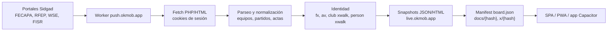

# 02 · Fuentes e ingesta

**Fecha de observación:** 21/10/2026 (UTC)
**Confianza:** A para artefactos y respuestas; B para el pipeline interno, que no es público.

---

## 1. Resumen

OKMob no tiene una fuente de datos propia. Construye su producto sobre **Sidgad**, la misma plataforma que alimenta los portales oficiales de FECAPA, RFEP y World Skate Europe, y que Stick Live ya utiliza para RFEP y World Skate. La diferencia no está en el acceso al dato, sino en la **cobertura**, la **normalización**, la **identidad** y la **experiencia**.

La documentación de Stick Live describe los endpoints de Sidgad como «APIs JSON internas». El cliente real de Stick Live (`apps/scraper/src/scrapers/fep/sidgad-client.ts`) hace peticiones GET/POST a `{portal}_*.php`, mantiene cookies de sesión y devuelve **texto**; los parsers trabajan con HTML. Es la misma familia de endpoints PHP que usa OKMob. Conviene corregir esa descripción en `docs/pipeline-datos.md` para no construir expectativas equivocadas.

---

## 2. Fuentes declaradas por el operador

| Documento | Fecha | Fuentes que declara | Otras afirmaciones | Confianza |
|---|---|---|---|---|
| Términos y condiciones | 2026-10-10 | FECAPA, RFEP y World Skate Europe | OKMob es independiente; no hay relación con las federaciones; prohíbe el scraping de OKMob | C |
| «Sobre» | 2026-10-07 | FECAPA, RFEP y World Skate Europe | Sin registro, sin suscripciones, solo anuncios; no mantiene copia propia; asistente con modelos | C |
| FAQ | 2026-10-07 | Federaciones y portales oficiales | La cronología depende del detalle de la fuente; búsqueda limitada; sin push web con la pestaña cerrada | C |
| Ficha de App Store | 21/10/2026 | — | Idiomas ES + 2; anuncios; Live Activities | C |
| Ficha de Google Play | 21/10/2026 | — | 1K+ instalaciones; anuncios | C |

**Observación:** FISR (Italia) **no aparece** en ninguno de los tres documentos del operador, pero el bundle tiene `fedFisr: true`, el ticker de FISR responde y se observó un partido FISR en el documento `x` del directo. Es una fuente técnica y no declarada.

---

## 3. La huella de Sidgad

La identificación de Sidgad no depende de una afirmación del operador. Se sostiene en artefactos independientes:

| Evidencia | Qué muestra | Confianza |
|---|---|---|
| `https://sidgad.cloud/fecapa/images/...` en los escudos | Los logos se sirven desde el dominio de Sidgad. | A |
| CSP `connect-src https://www.server2.sidgad.es` | El cliente web puede hablar directamente con el servidor PHP de Sidgad. | A |
| IDs `idc` / `idp` y parámetros `temp` | Nomenclatura exacta de Sidgad. | A |
| `ticker?f=fisr` devuelve HTML con `idc='$id_liga'` | Es una página PHP de Sidgad sin procesar, con placeholders de plantilla. | A |
| Portal FECAPA: «Powered by SIDGAD SOFTWARE (CLOUD SERVER PRO)» | El portal oficial usa Sidgad. | A |
| Misma temporada `39` = 2025/26 y `41` = 2026/27 en varias federaciones | Sidgad comparte el diccionario de temporadas entre portales. | A |
| El cliente de Stick Live usa `server2.sidgad.es/{portal}/{portal}_*.php` con cookies | Stick Live consume la misma familia de endpoints. | A |

**Conclusión:** OKMob y Stick Live no compiten por una fuente exclusiva; compiten por **qué hacen con la misma fuente**.

---

## 4. Cobertura observada

Datos del catálogo `https://push.okmob.app/comps` (21/10/2026, 16:04 UTC; `max-age` 11.582 s).

| Federación | Prefijo de `idc` | Competiciones | Vigentes | Filas de equipo | Temporadas | Confianza |
|---|---|---:|---:|---:|---|---|
| FECAPA | numérico (`4858`) | 159 | 110 | 2.106 | 39 (2025/26) y 41 (2026/27) | A |
| RFEP | `R` (`R3575`) | 37 | 28 | 238 | 39 y 41 | A |
| World Skate | `W` (`W260`) | 17 | 17 | 153 | 39 y 41 | A |
| FISR | `I` (`I1898`) | No aparece en `comps` | — | — | — | B |
| FPP / FFRS | — | Flags `fedFpp` / `fedFfrs` en `false` | — | — | — | A |

El catálogo incluye además:

- `clubs`: 56 mappings de club entre federaciones (por ejemplo, `rfep:101` ↔ `fecapa:271`).
- `phases`: 47 mappings de competición a nombres de fase.
- `spans`: 90 rangos de fechas por competición, con número de días.
- `popular`: contadores de popularidad. Los primeros son `W325` (4.914), `4781` (3.281), `4784` (3.039), `R3575` (2.073) y `4858` (1.148).
- `updated`: timestamp de generación del catálogo.

**Lectura:** la cobertura FECAPA es la diferencia más visible. Stick Live tiene el parser y el registro de FECAPA (`apps/etl/src/federations.ts`), pero la documentación interna lo sitúa como pendiente de activación. OKMob ya lo opera con 159 competiciones y 110 vigentes.

---

## 5. Espacios de identificadores y colisiones

### 5.1 Prefijos

| Federación | `idc` | `idp` | Ejemplo | Notas |
|---|---|---|---|---|
| FECAPA | Numérico | Numérico | `4858`, `164291` | Sin prefijo. El portal usa `fecapa_*`. |
| RFEP | `R` | `R` | `R3575`, `R35530` | El prefijo es obligatorio en la práctica. |
| World Skate | `W` | `W` | `W260`, `W3079` | El portal oculto usa `idc=260`, pero la API pública necesita `W260`. |
| FISR | `I` | `I` | `I1898`, `I29687` | Italia. No declarado en los términos. |

### 5.2 La colisión observada

- `https://push.okmob.app/calendar.json?idc=260` devuelve datos de **FECAPA 2021** (categorías base), no de World Skate.
- `https://push.okmob.app/calendar.json?idc=W260` devuelve la **Champions League de World Skate** (por ejemplo, Porto 6–2 Liceo, 06/05/2026).

El prefijo no es una comodidad: es la única separación entre federaciones que comparten rango numérico. Un consumidor que omita el prefijo obtiene **datos válidos de otra federación**, sin error. Es un riesgo de integridad serio para cualquier cliente, incluido un futuro conector de Stick Live.

### 5.3 `fx` y `av`

- `fx` es la identidad de un partido para la ruta `/c/:idc/p/:fx`. El formato base observado es `{idc}|{iso}|{homeTeamId}|{awayTeamId}`.
- En partidos futuros sin `idp`, el `.ics` usa un sufijo `|tHH:MM` para desambiguar la hora: `...|t12:00`.
- `av` es una versión/hash del acta. El acta `164291` se sirve como `https://live.okmob.app/arc/acta/164291/1b07bce2a1a06171.json`, con `Cache-Control: public, max-age=31536000, immutable` y `Last-Modified: 18/10/2026 20:04:55`.

**Consecuencia:** la URL del acta es estable y cacheable durante un año, pero no es «la fuente»: es una **copia normalizada y versionada**. La versión cambia cuando cambia el contenido, no cuando cambia el partido.

### 5.4 Identidad de equipo y de club

- La ruta `/e/:team` usa una clave con formato `{teamId}~{competición}~{nombre}` (ejemplo del sitemap: `234~Nacional Catalana~BARÇA`).
- `team.ics` acepta exactamente esa clave: `?id=234~Nacional%20Catalana~BAR%C3%87A`.
- Por tanto, la ficha de equipo es **por competición**, no una entidad global.
- `comps.clubs` aporta 56 mappings de club entre federaciones; no se verificó si `/club/:club` los usa para agregar todas las secciones.

### 5.5 Identidad de persona

`https://live.okmob.app/ref/person-xwalk.json` es un crosswalk estático:

- `v: 1`, `hash: 17qkju3jt24`, `built: 2026-10-21T12:15:44.090Z`.
- 1.004 personas; 59.861 bytes; `max-age` 21.600 s (6 h).
- 855 personas (85,2 %) aparecen en más de una federación.
- 108 personas están en FECAPA + RFEP + World Skate.
- 610 solo en FECAPA + RFEP; 70 solo en FECAPA + World Skate; 67 solo en RFEP + World Skate; 145 solo en World Skate; 4 solo en FECAPA. No hay personas solo en RFEP.
- No hay IDs de FISR en el archivo (0), aunque `fedFisr` esté activo.

Ejemplo de entrada:

```json
{
  "key": "p10h0kt3dq9",
  "fecapa": ["10019"],
  "rfep": ["R4003"],
  "ws": ["W9455"]
}
```

El archivo **no contiene nombres ni fechas de nacimiento**: solo claves internas y arrays de IDs por federación. Es una decisión de privacidad razonable y, a la vez, una muestra de que la identidad se resuelve fuera del cliente.

**No se sabe** cómo se genera el crosswalk (¿nombre + club + fecha de nacimiento?, ¿revisión manual?). La calidad del cruce no se puede auditar desde fuera. Pero su existencia cambia la comparación: OKMob no está solo agregando partidos; está construyendo una **capa de identidad de jugador** que Stick Live todavía no tiene.

---

## 6. Pipeline de ingesta (inferido)



### 6.1 Evidencia de parseo HTML

El chunk `queries-X981_b0k.js` contiene constantes que parecen selectores/clases del HTML de Sidgad:

`nombre_junto_logo`, `team_logo`, `logos_clubes`, `game_report`, `web_link_td`, `div_titulo_fase_idc`, `head_jornada`, `tabla_standard_less`, `lang_label`, `lang_ca`, `nombre_equipo_thickbox_stats`, `nombre_ficha_jugador_plus`, `fila_stats_player`.

No se verificó el uso exacto de cada una, pero el conjunto es consistente con un parser de las páginas PHP de Sidgad, no con un contrato JSON estable.

### 6.2 Evidencia del ticker

`https://push.okmob.app/ticker?f=fisr` devuelve **898.847 bytes** de HTML, con:

- 829 referencias a `idp=`.
- 389 ocurrencias de `idc='$id_liga'` (placeholder de plantilla).
- Clases de partido en vivo (`live`, `score`, `period`).

Es un artefacto crudo de Sidgad. OKMob lo publica o lo transforma, pero la materia prima es HTML.

### 6.3 Evidencia del acta

El acta `164291` se genera desde el HTML oficial y se publica como JSON normalizado. La respuesta no incluye `idp`, `idc` ni fecha; el contexto viene de la URL. Es un contrato **ad hoc**, no un recurso autocontenido.

### 6.4 Evidencia del catálogo

`comps` es un agregado precalculado: competiciones, equipos, clubs, fases, spans y popularidad. Se sirve con `max-age` de 3,2 h. Esto sugiere un proceso batch/worker que reconstruye el catálogo, no una consulta por request.

### 6.5 Evidencia del crosswalk

`person-xwalk.json` es un archivo de referencia generado a las 12:15 UTC del 21/10/2026. No se sirve desde el worker como una consulta; es un snapshot estático. Lo mismo ocurre con `rules.json` (versión 7) y `comps`.

---

## 7. Normalización e identidad

| Elemento | Cómo lo representa OKMob | Implicación |
|---|---|---|
| Competición | `idc` con prefijo implícito | Colisión si se omite el prefijo. |
| Partido | `idp` + `fx` compuesto | `fx` permite rutas sin `idp`; el `idp` sigue siendo la clave de acta. |
| Acta | `av` / hash de contenido | Versionado inmutable; fácil de cachear; difícil de auditar sin el `idp`. |
| Equipo | `teamId~competición~nombre` | Identidad por competición; el club se agrega aparte. |
| Club | mapping `rfep:101` ↔ `fecapa:271` | 56 mappings; no se verificó su exhaustividad. |
| Persona | `key` + arrays por federación | 1.004 personas; 85,2 % multi-federación; sin FISR. |
| Regla | `rules.json` por temporada | 43 reglas 2025/26, 23 en 2026/27; fuente citada. |
| Fase / span | `phases`, `spans` | Fechas y nombres de fase precalculados. |

**Fortaleza:** OKMob separa la identidad de la presentación. `fx`, `av`, `person-xwalk` y `clubs` son capas distintas. Eso facilita el cacheo y la reutilización.

**Debilidad:** el prefijo de federación es implícito y el acta no se autodescribe. La identidad depende de convenciones externas, no de un tipo explícito.

---

## 8. Política de red y tasa

`config.json` declara:

```json
{
  "net": {
    "doors": true,
    "families": ["Z", "P1", "P2", "P3", "P4", "P5"],
    "policy": {
      "sidgad": {
        "perMin": 12,
        "burst": 6,
        "concurrency": 3,
        "lowPer5Min": 20
      }
    },
    "boardViaDoorMs": 60000
  }
}
```

Interpretación (B): OKMob limita sus peticiones a Sidgad a 12 por minuto, con ráfagas de 6, concurrencia 3 y un modo «low» de 20 peticiones cada 5 minutos. `boardViaDoorMs` sugiere un fallback al manifiesto a través de los «doors» (réplicas en `okmob-door-*.pages.dev`) tras 60 s.

No se observó el scheduler real ni se midió su frecuencia. La política es coherente con un scraper educado, pero no prueba que se cumpla en todos los casos.

---

## 9. Caché y TTL

| Recurso | `Cache-Control` observado | TTL efectivo | Notas |
|---|---|---:|---|
| `live/board.json` | `max-age=10` (aprox.) | 10 s | Manifiesto de directo. |
| `live/docs/{hash}.json` | `immutable` | 1 año | Índice de documentos calientes. |
| `live/x/{hash}.json` | `immutable` | 1 año | Bundle de directo. |
| `live/acta/{id}/{hash}.json` / `arc/acta/...` | `public, max-age=31536000, immutable` | 1 año | Acta versionada. |
| `comps` | `max-age=11582` | ~3,2 h | Catálogo completo. |
| `calendar` / `standings` | `max-age=900` | 15 min | Datos de competición. |
| `rules.json` | `max-age=86400` | 24 h | Reglamento. |
| `config.json` | `max-age=300` | 5 min | Flags y política. |
| `person-xwalk.json` | `max-age=21600` | 6 h | Crosswalk de personas. |
| `team.ics` | `max-age=3600` | 1 h | Calendario de equipo. |
| `calendar.json?idc=260` (FECAPA 2021) | `max-age=86400` | 24 h | Histórico. |

**Lectura:** el directo se mantiene fresco con un manifiesto de 10 s y documentos inmutables; el catálogo y las reglas se cachean horas. Es una arquitectura de **cache-first** bien adaptada a una CDN, no una API transaccional.

---

## 10. Fidelidad y calidad

| Aspecto | Observación | Confianza |
|---|---|---|
| Marcador, árbitros, pabellón, goleador | Coinciden con el acta oficial de FECAPA `164291`. | A |
| Faltas directas y faltas de equipo | Coinciden (12/10 y dos FD). | A |
| Amarillas de banquillo | Coinciden (Cabestany y Ares Lozano). | A |
| Eventos de jugador | Solo 4 eventos; el acta oficial incluye expulsiones de 2 minutos, tiempos muertos y más acciones. | A |
| Tarjetas/faltas de jugador | Todos los contadores a cero en la muestra. | A |
| `P10 00:00` | Es nomenclatura oficial; no es un bug de OKMob. | A |
| Orden de `events` | El array no está ordenado por tiempo (P2 10:36 antes de P2 06:55 y P2 06:00). | A |
| Autodescripción del acta | No incluye `idp`, `idc` ni fecha. | A |
| Esquemas entre endpoints | `homeScore`/`awayScore` en acta; `score` en calendario; `homeLogo` vs `home_logo` en `day`. | A |
| RFEP Jornada 4 | 7/7 resultados coinciden. | A |
| World Skate profundo | No se pudo comparar acta. | D |
| FISR | Partido en vivo observado; sin comparación oficial. | B |

**Conclusión:** OKMob es fiable para el **resultado y el contexto del partido**, pero no es un espejo completo del acta oficial. La diferencia es material para una promesa de «acta completa» y debe explicarse al usuario.

---

## 11. Transparencia y contradicciones

### 11.1 FISR no declarada

Los términos, «Sobre» y FAQ nombran FECAPA, RFEP y World Skate Europe. El bundle activa `fedFisr`, el ticker responde y hay un partido FISR en el directo. No se encontró una explicación pública. Es una **brecha de transparencia**, no necesariamente un problema legal.

### 11.2 «No mantiene copia propia» vs archivo inmutable

«Sobre» afirma que OKMob «no en manté cap còpia pròpia». Sin embargo:

- `acta.json` redirige a `live.okmob.app/arc/acta/164291/1b07bce2a1a06171.json`.
- La respuesta tiene `max-age=31536000, immutable`.
- `config.flags.arcActa` está en `true`.

Técnicamente hay un **snapshot normalizado y cacheado durante un año**. La frase puede querer decir «no tenemos una base de datos propia de la que seamos responsables», pero la formulación es ambigua y contradice el comportamiento observable. Debe citarse con cuidado.

### 11.3 Scraping de OKMob

Los términos prohíben el scraping de OKMob. Esta auditoría usó una muestra pequeña y razonada, sin automatización masiva, y no reutiliza su contenido. La restricción es relevante para cualquier futura integración: **no se debe ingerir OKMob como fuente**.

### 11.4 Publicidad y datos

La app es ads-only según «Sobre» (sin suscripciones ni compras). La CSP y el bundle confirman AdSense/AdMob y FCM. No se observó una capa de pago. Los datos públicos de la ficha de App Store indican `hasInAppPurchases: false` e `isFree: true`; no se observaron compras integradas ni suscripciones. No se puede descartar un pago fuera de la app o una función futura, pero no hay evidencia pública de ello.

---

## 12. Comparación con la ingesta de Stick Live

| Dimensión | OKMob | Stick Live | Lectura |
|---|---|---|---|
| Fuente | Sidgad PHP/HTML | Sidgad PHP/HTML | Misma materia prima. |
| Cobertura | FECAPA + RFEP + WSE + FISR | RFEP + WSE; registro FECAPA/FMP/FAP/FPCV/FGP con activación pendiente | OKMob lidera en Cataluña. |
| Identidad de partido | `idp` + `fx` + `av` | `source_ref` idempotente + UUID | OKMob tiene `fx` y versionado; Stick Live tiene integridad transaccional. |
| Identidad de jugador | `person-xwalk` (1.004; 85,2 % multi-fed) | `players.source_ref`, sin crosswalk entre fuentes | OKMob lidera. |
| Identidad de club | 56 mappings en `comps.clubs` | ER de clubes/equipos documentado | Stick Live tiene un modelo más formal; OKMob tiene un mapping útil. |
| Reglas | `rules.json` con zonas y cascadas | No equivalente | OKMob lidera. |
| Persistencia | Snapshots estáticos | PostgreSQL + migraciones + tests | Stick Live lidera en operación. |
| Frecuencia | Manifiesto 10 s; worker | Polling 45 s; caché API 30–300 s + SWR | OKMob es más agresivo en frescura; Stick Live es más controlable. |
| Documentación | No pública | `docs/` extensa (con alguna imprecisión) | Stick Live lidera. |

**Recomendación:** no copiar el pipeline estático. Stick Live ya tiene una base transaccional mejor. Lo que debe copiar es el **modelo de identidad** (persona y club), la **cobertura FECAPA** y la **disciplina de TTL** para datos históricos.

---

## 13. Incógnitas

- ¿Cómo se genera exactamente el `person-xwalk`? ¿Qué umbral de similitud, qué campos y qué revisión manual?
- ¿La cobertura FISR es permanente o un experimento?
- ¿El worker usa R2, KV o ambos? Se infiere almacenamiento de objetos por la inmutabilidad y los hashes, pero no se verificó.
- ¿Con qué frecuencia se reconstruyen `comps`, `rules` y `person-xwalk`?
- ¿OKMob respeta `robots.txt` de los portales de origen? No se puede saber desde fuera.
- ¿Cómo se resuelven los partidos sin `idp` en el calendario? El sufijo `|tHH:MM` es una pista, no una especificación.
- ¿La frase «no mantiene copia propia» tiene una interpretación jurídica distinta de «snapshot inmutable»? No hay documentación.
