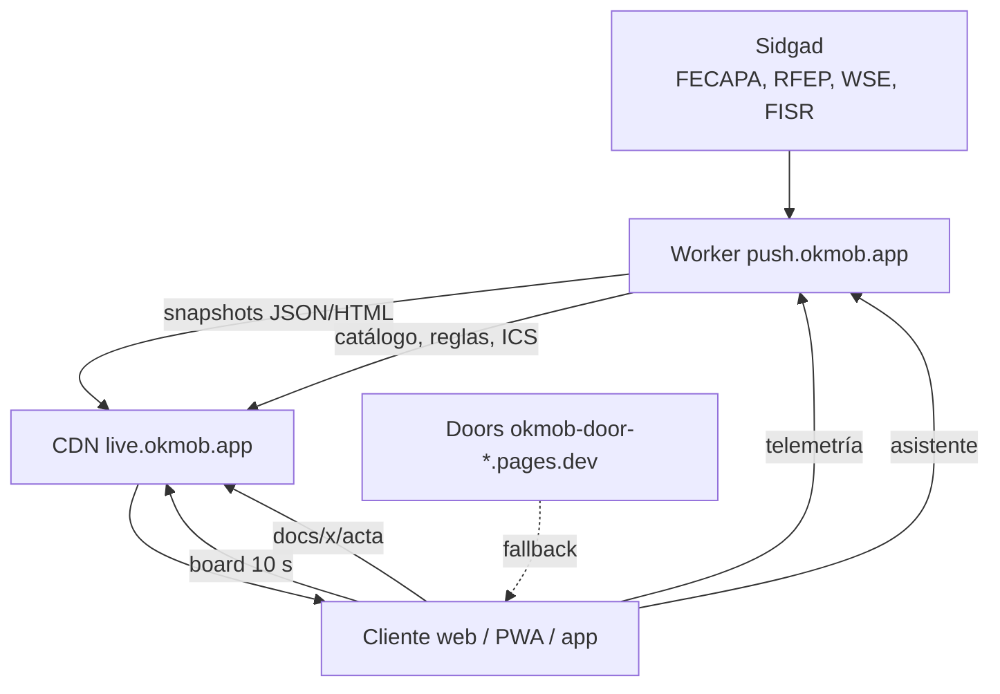

# 03 · API y arquitectura del directo

**Fecha de observación:** 21/10/2026 (UTC)
**Confianza:** A para endpoints, esquemas y cabeceras observadas; B para la topología interna y el scheduler.

---

## 1. Resumen

OKMob no expone una API REST transaccional. Expone un **catálogo de recursos estáticos direccionados por contenido** en `live.okmob.app`, alimentado por un worker en `push.okmob.app`. El directo se resuelve con:

1. Un manifiesto pequeño (`board.json`) que se refresca cada **10 s**.
2. Un índice de documentos calientes (`live/docs/{hash}.json`) con hashes, timestamps y ventanas de validez.
3. Un bundle de directo (`live/x/{hash}.json`) con partidos, actas, tickers y días.
4. Snapshots inmutables de actas, días y tickers.

El cliente no consulta la base de datos de OKMob: consulta la CDN. Eso abarata el coste y reduce el acoplamiento, pero traslada la complejidad al **worker de ingesta** y a la **invalidación por hash**.

---

## 2. Topología



**Observación:** `push.okmob.app` sirve tanto el worker como algunos recursos derivados (`comps`, `calendar`, `standings`, `acta.json`, `rules.json`, `config.json`, `team.ics`, `arxiu`, `day`, `ticker`). `live.okmob.app` sirve los snapshots inmutables y el crosswalk de personas. La separación no es estricta: algunos recursos se sirven desde el worker y redirigen a la CDN.

---

## 3. Inventario de endpoints públicos

Método `GET` salvo indicación. No se probaron escrituras.

| Endpoint | Respuesta | Tamaño observado | Caché | Uso |
|---|---|---:|---|---|
| `GET https://push.okmob.app/config.json` | Flags, versión, política de red | ~2 KB | 300 s | Configuración del cliente. |
| `GET https://push.okmob.app/comps` | Catálogo de competiciones, equipos, clubs, fases, spans y popularidad | ~353 KB | 11.582 s | Bootstrap del producto. |
| `GET /calendar.json?idc={idc}` | Jornadas, partidos, resultados, `video`, `av`, `idp` | 7–40 KB | 900 s | Calendario de competición. |
| `GET /standings.json?idc={idc}` | Grupos, filas y `priors` | 5–20 KB | 900 s | Clasificación. |
| `GET /acta.json?idp={idp}&idc={idc}` | Acta normalizada; redirige a `live/arc/acta/...` | 5,4 KB (ejemplo) | 1 año, inmutable | Ficha de partido. |
| `GET /scorers.json?idc={idc}&type={type}` | Goleadores | 5–20 KB | 900 s | Estadísticas. |
| `GET /profiles.json?id_player={id}&idc={idc}&idm={idm}&temps={temp}` | Ficha de jugador con secciones | 10–40 KB | 900 s | Jugador. |
| `GET /highlights.json?idc={idc}` | Vídeos/resúmenes | variable | 900 s | Highlights. |
| `GET /rules.json?v=7` | Reglamento por temporada | 40,5 KB | 86.400 s | Reglas y zonas. |
| `GET /arxiu?f={fed}` | Archivo de competiciones | 5–20 KB | variable | Histórico. |
| `GET /day?date={YYYY-MM-DD}&f={fed}` | Partidos del día | 7,4 KB | 900 s | Agenda. |
| `GET /ticker?f={fed}` | HTML crudo del ticker | 898 KB (FISR) | variable | Directo. |
| `GET /team.ics?id={teamKey}` | Calendario iCalendar | 44 KB (60 eventos) | 3.600 s | Suscripción. |
| `GET https://live.okmob.app/ref/person-xwalk.json` | Crosswalk de personas | 59,9 KB | 21.600 s | Identidad. |
| `GET https://live.okmob.app/live/board.json` | Manifiesto de directo | 624 B | 10 s | Polling. |
| `GET https://live.okmob.app/live/docs/{hash}.json` | Índice de documentos calientes/fríos | 47,9 KB | 1 año, inmutable | Delta. |
| `GET https://live.okmob.app/live/x/{hash}.json` | Bundle de directo | ~10–50 KB | 1 año, inmutable | Partidos/actas/ticker. |
| `GET https://live.okmob.app/live/day/{date}/{hash}.json` | Snapshot del día | ~10 KB | 1 año, inmutable | Agenda. |
| `GET https://live.okmob.app/live/acta/{id}/{hash}.json` | Snapshot de acta | ~5 KB | 1 año, inmutable | Ficha. |
| `GET https://live.okmob.app/live/ticker/{hash}.html` | Snapshot del ticker | variable | 1 año, inmutable | Directo. |
| `GET https://live.okmob.app/arc/acta/{id}/{hash}.json` | Archivo de acta | ~5 KB | 1 año, inmutable | Verificación. |

### 3.1 Endpoints de escritura o telemetría (no auditados)

| Endpoint | Método | Evidencia | Estado |
|---|---|---|---|
| `/chat` | POST | Bundle `index-DaXZKQVK.js` | No probado. |
| `/chat/parse` | POST | Bundle | No probado. |
| `/chat/credits` | GET | Bundle | No probado. |
| `/chat/report` | POST | Bundle | No probado. |
| `/event` | POST (sendBeacon) | Bundle `push-CVdkmiEk.js` | No probado. |
| `/report` | POST (sendBeacon) | Bundle | No probado. |
| `/sync` | — | Referencia en el bundle/service worker | No verificado. |
| `/debug` | GET | Ruta pública | No auditada. |

**Riesgo:** CORS es `access-control-allow-origin: *` y permite `GET, POST, OPTIONS`. Los endpoints de escritura/telemetría son alcanzables desde cualquier origen. No se evaluó si tienen rate limit, captcha, autenticación o validación. No se enviaron datos.

---

## 4. El manifiesto `board.json`

Respuesta observada (21/10/2026, 16:58:32 UTC):

```json
{
  "schema": 1,
  "observedAt": "2026-10-21T16:58:32.948Z",
  "stale": false,
  "nextPoll": 300,
  "games": [],
  "feds": {},
  "publishedAt": "2026-10-21T16:58:34.212Z",
  "phase": {
    "at": 1792601914212,
    "next": 1792601944212,
    "every": 30000
  },
  "actas": {},
  "ticker": {
    "v": "4877161e79388b47",
    "nextPoll": 300,
    "at": 1792553708247
  },
  "days": {
    "2026-10-20": { "v": "6ffa25e8115481e2", "at": 1792574612221 },
    "2026-10-21": { "v": "ab15b3459e3d654a", "at": 1792590693173 },
    "2026-10-22": { "v": "35c6d57dec5086bc", "at": 1792533607132 }
  },
  "docs": {
    "hot": { "v": "d38611cd042ec1b5", "at": 1792601913796 },
    "cold": { "v": "40ea1a7e072e0b20", "at": 1792533606134 }
  },
  "x": { "v": "100b9e666a099cdb", "at": 1792601914384 }
}
```

Campos:

| Campo | Significado | Nota |
|---|---|---|
| `schema` | Versión del manifiesto | `1`. |
| `observedAt` | Cuándo se generó el dato | UTC ISO. |
| `publishedAt` | Cuándo se publicó | UTC ISO. |
| `stale` | Si el manifiesto está servido desde una copia vieja | `false` en la muestra. |
| `nextPoll` | Segundos sugeridos hasta el próximo sondeo | `300` en reposo. |
| `games` | Partidos en vivo | Vacío en la muestra. |
| `feds` | Federaciones activas | Vacío en la muestra. |
| `phase.at` / `phase.next` / `phase.every` | Ventana de fase de 30 s | El cliente alinea el polling. |
| `actas` | Actas en curso | Vacío en la muestra. |
| `ticker` | Hash y `nextPoll` del ticker | `v` de 16 hex. |
| `days` | Hashes por fecha | Ayer, hoy y mañana. |
| `docs.hot` / `docs.cold` | Hashes de los índices | `v` + `at`. |
| `x` | Hash del bundle de directo | `v` + `at`. |

**Diseño:** el manifiesto no incluye los datos; incluye **punteros**. El cliente pide solo lo que cambió. Es un patrón de «manifest + delta» adaptado a una CDN.

---

## 5. El índice `docs/{hash}.json`

Respuesta observada (`hot`, hash `d38611...`):

```json
{
  "schema": 1,
  "part": "hot",
  "seq": 1866,
  "at": 1792601913796,
  "cut": 1792274406134,
  "d": {
    "cal:4858": ["69055d009932cacd", 1792353432364, 1792168176908, 1792772975668],
    "fix:3938": ["b6b66f4b0903efe9", 1792330945523, 1792601270464, 1792603070464],
    "sco:3923:asistencias": ["cd7a07ef96032102", 1792336316171, 1792261538135, 1792866336990],
    "std:3058": ["3b3157b8de97fa65", 1792507636779, 1792136648814, 1792741447663]
  }
}
```

- `part`: `hot` o `cold`.
- `seq`: secuencia del índice (1.866 en la muestra).
- `at`: generación.
- `cut`: timestamp de corte.
- `d`: mapa `clave → [hash, at, validFrom, validUntil]`.

Conteo observado del índice caliente:

| Prefijo | Entradas | Significado |
|---|---:|---|
| `cal:` | 233 | Calendarios de competición. |
| `fix:` | 120 | Fixtures/agenda. |
| `sco:` | 135 | Goleadores. |
| `std:` | 141 | Clasificaciones. |
| **Total** | **629** | — |

De las 629 entradas, **508 tenían `validUntil` futuro** y **121 ya estaban fuera de ventana** en el momento de la observación. Las ventanas llegan hasta el 19/11/2026. El índice conserva entradas caducadas; el cliente decide si las usa o las refresca. No se verificó la política de evicción.

---

## 6. El bundle `x/{hash}.json`

Respuesta observada (`100b9e...`):

```json
{
  "games": [
    {
      "fx": "I1898|2026-10-21|5437|5558",
      "idc": "I1898",
      "idp": "I29687",
      "status": "live",
      "score": [0, 0],
      "home": "MOP",
      "away": "TRI-F"
    }
  ],
  "actas": {
    "I29687": {
      "v": "c37e39d3c56ba48d",
      "period": "TEMPO 2",
      "clock": "15:00",
      "clockPeriod": "P2",
      "score": [0, 0],
      "ev": 0,
      "evSig": "45h",
      "final": false,
      "at": 1792601913501,
      "stale": false,
      "pv": "2f65beab7eddb9f2",
      "fo": [1, 0],
      "vAt": 1792601853619
    }
  },
  "feds": { "fisr": "hot" },
  "ticker": "<!--okmob:fisr--><style>...",
  "days": {},
  "nextPoll": 300
}
```

Campos relevantes:

- `games[].fx`: identidad del partido.
- `games[].idp`: identidad del acta; puede ser `null` en un partido futuro.
- `status`: `live`, `final`, etc.
- `actas[idp].v`: hash de la versión del acta.
- `actas[idp].ev`: número de eventos.
- `actas[idp].evSig`: firma de eventos para detectar cambios.
- `actas[idp].final`: si el acta está cerrada.
- `actas[idp].stale`: si el dato es viejo.
- `actas[idp].pv`: hash del pabellón.
- `actas[idp].fo`: faltas de equipo `[home, away]`.
- `ticker`: HTML del ticker, no JSON.

**Observación:** el bundle mezcla JSON y HTML. El ticker se inserta como string; el cliente lo renderiza. Es una integración pragmática, pero impide validar el HTML como dato estructurado y aumenta el riesgo de XSS si no se sanitiza. No se verificó el saneamiento.

---

## 7. Snapshots de día, acta y ticker

### 7.1 `day`

`GET /day?date=2026-10-21&f=fecapa` devuelve partidos con:

- `idp` (puede ser `null`), `fx`, `phase`, `score`, `status`.
- `home`/`away` y `home_logo`/`away_logo`.
- `date`, `time`, `venue`.

**Inconsistencia:** el calendario usa `homeLogo`/`awayLogo`; el día usa `home_logo`/`away_logo`. No hay un esquema compartido.

### 7.2 `acta`

El acta normalizada tiene 12 claves:

`homeScore`, `awayScore`, `period`, `clock`, `clockPeriod`, `venue`, `referees`, `homeFouls`, `awayFouls`, `home`, `away`, `events`.

- `home`/`away`: `name`, `players[]`, `staff[]`, `scorers[]`.
- `players[]`: `id`, `dorsal`, `name`, `goals`, `assists`, `fouls`, `isGoalkeeper`, `starter`, `captain`, `yellow`, `blue`, `red`.
- `staff[]`: `name`, `roleKind`, `yellow`, `blue`, `red`.
- `events[]`: `type`, `period`, `clock`, `team`, `player`, `assist`, `score`.

**Problemas de contrato:**

1. No incluye `idp`, `idc` ni fecha. El consumidor depende de la URL.
2. Usa `homeScore`/`awayScore` (strings) en vez de `score` (array).
3. `events` no está ordenado cronológicamente.
4. Mezcla idiomas: `period: "FINALIZAT"`, `clockPeriod: "P10"`, nombres en mayúsculas.
5. No hay un campo de exhaustividad (`complete`, `sourceDetail`) que permita saber si faltan eventos.

### 7.3 `ticker`

El ticker es HTML de Sidgad. En FISR, 898 KB con 829 `idp` y 389 placeholders `idc='$id_liga'`. Es el recurso más pesado y el más frágil. El cliente lo pide solo para la federación activa; no se verificó si se cachea en IndexedDB.

---

## 8. Lógica de polling

El chunk `queries-X981_b0k.js` contiene la política exacta:

- `staleTime: 10.000` ms para `liveBoard`.
- `refetchInterval`:
  - Si no hay board, o el board está stale, o hay un partido `live` → **15 s**.
  - Si hay un acta no final y no marcada `na` → **15 s**.
  - Si no, toma `nextPoll` (segundos) × 1000:
    - si no es finito o es **menor de 300.000 ms (300 s)** → **15 s**;
    - si es mayor o igual, `min(nextPoll, 120.000 ms)` → **120 s**.
- `retry: false`.
- Se pausa cuando `document.visibilityState === 'hidden'`.
- `phase.every = 30.000` ms: el cliente alinea el sondeo a una fase de 30 s y evita ráfagas; `No()` impone un mínimo de 60 s respecto al cuarto sondeo previo.
- `edgeLive`: si está activo, el cliente usa un board «edge» con parámetros `u=` / `t=` para consultas condicionales; si no, usa el board normal.

**Traducción:** en un partido en vivo, el cliente pregunta cada 15 s; en reposo, cada 2 minutos como máximo. El servidor publica la fase cada 30 s. No es un websocket ni SSE: es polling con cache y alineación.

---

## 9. Caché, rendimiento y coste

### 9.1 TTLs

| Recurso | TTL | Estrategia |
|---|---:|---|
| `board.json` | 10 s | Revalidación frecuente. |
| `docs/x/day/acta/ticker` | 1 año, inmutable | Hash de contenido. |
| `comps` | 3,2 h | Catálogo batch. |
| `calendar` / `standings` | 15 min | Datos de competición. |
| `rules` | 24 h | Cambio poco frecuente. |
| `config` | 5 min | Flags. |
| `person-xwalk` | 6 h | Snapshot de identidad. |
| `team.ics` | 1 h | Calendario. |

### 9.2 Tamaños y coste

- `board.json`: 624 B. Es el único recurso que se pide con frecuencia.
- Índice caliente: 47,9 KB; se pide cuando cambia el hash.
- `x`: ~10–50 KB; se pide cuando cambia el hash.
- `comps`: 353 KB; se pide al arrancar y se cachea 3,2 h.
- `ticker` FISR: 898 KB; el caso más pesado.
- `person-xwalk`: 59,9 KB; 6 h.

**Ventaja:** no hay base de datos por request. La CDN absorbe el tráfico y el worker solo publica snapshots. El coste marginal por usuario es bajo.

**Riesgo:** el `board.json` es una **clave caliente**. La fase de 30 s y el mínimo de 60 s reducen el thundering herd, pero no lo eliminan. No se midió el rendimiento bajo carga.

### 9.3 Cabeceras

- `server: cloudflare`.
- `cf-cache-status: HIT` en la mayoría de recursos.
- `etag` en actas (`W/"921cad2c84953f986e60045ca7f17d0f"`).
- `server-timing: cfCacheStatus;desc="HIT", cfEdge;dur=18, cfOrigin;dur=0`.
- `content-encoding: br` en `comps`.
- `access-control-allow-origin: *`.

No se midió TTFB ni latencia de extremo a extremo. No se hizo prueba de carga.

---

## 10. Fiabilidad

### 10.1 Mecanismos observados

- `stale` en board y actas.
- `observedAt` / `publishedAt` / `at` / `vAt`.
- `validFrom` / `validUntil` en el índice.
- `X-OKMob-Stale`, `X-OKMob-Fetched-At`, `X-OKMob-Local` en respuestas locales del service worker.
- Doors `okmob-door-*.pages.dev` y `boardViaDoorMs: 60000`.
- `stallGuard`, `livePhase`, `edgeIndex`, `resultRegistry`, `arcActa`.
- Reintento de chunks y `okmob-boot-stuck`.
- Telemetría de cliente `/event` y `/report` (no auditada).

### 10.2 Puntos débiles

- **Dependencia única de Sidgad.** Si el HTML cambia, el parser se rompe. No hay una fuente alternativa.
- **Cache inmutable de un año.** Un error de normalización publicado bajo un hash puede quedar cacheado mucho tiempo. La corrección exige un hash nuevo y actualizar el índice; no se verificó el proceso de rollback/purga.
- **Sin estado de salud público.** No se encontró `/health`, `/status` ni página de estado.
- **Sin SLA.** No hay documentación de disponibilidad.
- **Ticker HTML.** Alto riesgo de XSS si no se sanitiza; no se verificó.
- **CORS abierto.** Aceptable para lectura; discutible para POST.
- **Índice caliente con entradas caducadas.** 121 de 629 fuera de ventana; no se sabe si el cliente las descarta correctamente.
- **`nextPoll` del ticker.** El board usa `nextPoll: 300`, pero el ticker puede tener su propio `nextPoll`; la lógica exacta de prioridad no se verificó.

---

## 11. Seguridad

### 11.1 Cabeceras del sitio

- `Content-Security-Policy` estricta: `default-src 'self'`, `script-src` limitado a self, Cloudflare Insights y AdSense; `connect-src` incluye `www.server2.sidgad.es`, `push.okmob.app`, `live.okmob.app`, los doors, Tiivii, YouTube y AdSense.
- `Strict-Transport-Security` con `preload`.
- `frame-ancestors 'none'` (no clickjacking).
- `Permissions-Policy`: geolocalización self, micrófono self, cámara none.
- `Referrer-Policy` y `X-Content-Type-Options` presentes.

### 11.2 Superficie

- Lectura pública sin autenticación: es un producto de datos abiertos, no un fallo.
- Escritura/telemetría con CORS `*`: `/chat`, `/event`, `/report`, `/sync`. No se probaron. Si no tienen rate limit, podrían usarse para abuso/coste.
- `/debug` público: no se auditó; podría exponer información interna.
- `config.json` público: incluye flags y política de red, no secretos. Los IDs de Firebase/AdSense se redactan en este informe.
- El asistente recibe texto del usuario y puede llamar a modelos externos; el consentimiento existe (`okmob-ai-consent`), pero no se verificó la sanitización de prompts ni el coste.

**No se encontró evidencia de una vulnerabilidad explotable.** Se documentan riesgos, no hallazgos confirmados.

---

## 12. Comparación con Stick Live

| Dimensión | OKMob | Stick Live | Lectura |
|---|---|---|---|
| Transporte de directo | Polling 15 s + manifiesto 10 s | SSE `/matches/:id/stream` | SSE es más eficiente por cliente; OKMob es más simple y cacheable. |
| Fuente de verdad | Snapshots estáticos | PostgreSQL + API Hono | Stick Live tiene integridad transaccional; OKMob tiene cache. |
| Frecuencia de ingesta | Worker + fase 30 s | ETL 45 s + cron 5 min | Ambos son near-real-time; OKMob puede publicar antes, pero no se midió. |
| Caché | CDN con hashes inmutables | `read-cache` 30–300 s + SWR | OKMob es más agresivo y barato; Stick Live es más controlable. |
| SEO | CSR profundo | SSR Next.js | Stick Live lidera. |
| Observabilidad | Beacons de cliente; sin estado público | Sentry/PostHog; tests/CI | Stick Live lidera. |
| Escrituras | Asistente/telemetría; sin cuentas | Auth, favoritos, premium, push | Stick Live lidera. |
| Coste por lectura | Muy bajo | Moderado | OKMob lidera. |
| Complejidad operativa | Worker + CDN + hashes | DB + API + ETL + web | Stick Live es más complejo, pero más capaz. |

### Qué copiar y qué no

**Copiar:**

- TTLs largos para históricos y actas versionadas.
- `stale`/`observedAt`/`validUntil` en las respuestas.
- Un manifiesto ligero para clientes móviles/offline, si se necesita.
- La disciplina de no consultar la DB en cada request para datos históricos.

**No copiar:**

- Reescribir todo el backend como CDN estática. Stick Live necesita escrituras, auth, premium y SSE.
- Polling de 15 s para todo. SSE ya es más eficiente.
- Hashes inmutables de un año sin un plan de purga/rollback.
- Tickers HTML sin sanitizar.
- CORS `*` en endpoints de escritura.

---

## 13. Incógnitas

- ¿Dónde almacena el worker los snapshots? R2, KV o ambos; no se verificó.
- ¿Cómo se purgea un hash incorrecto? No hay documentación.
- ¿El `board.json` se genera cada 10 s o se sirve con `max-age=10`? La cabecera no se capturó con precisión; el `phase.every=30 s` sugiere una publicación cada 30 s y una caché de 10 s.
- ¿El cliente usa `edgeLive` en producción? El flag existe; no se confirmó su valor.
- ¿Los endpoints `/chat`, `/event`, `/report` tienen rate limit o autenticación? No se probaron.
- ¿`/debug` está protegido en producción? No se auditó.
- ¿El ticker se sanea antes de insertarlo? No se verificó.
- ¿El worker respeta los `robots.txt` de Sidgad? No se puede saber desde fuera.
