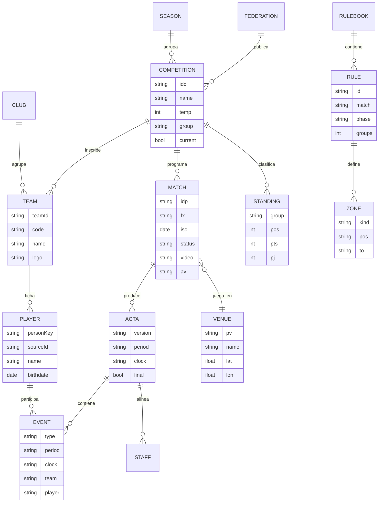

# 04 · Modelo de dominio

**Fecha de observación:** 21/10/2026 (UTC)
**Confianza:** A para campos observados; B para las relaciones inferidas. OKMob no publica un esquema formal.

---

## 1. Resumen

OKMob modela el hockey sobre patines con un conjunto de entidades **prácticas, orientadas a la fuente**: competición, equipo, partido, acta, jugador, clasificación, reglamento, pabellón y persona. No es un modelo normalizado al estilo de una base de datos relacional; es un modelo de **documentos** con claves compuestas y snapshots.

La pieza más interesante no es el partido: es la **capa de identidad**. OKMob resuelve:

- El partido con `idp` + `fx` + `av`.
- El equipo con `teamId~competición~nombre`.
- El club con un mapping entre federaciones.
- La persona con `person-xwalk` (1.004 personas; 85,2 % multi-federación).
- El pabellón con un hash `pv`.

Esa separación entre **identidad de fuente** y **presentación** es lo que permite agregar secciones, comparar y cachear sin duplicar todo.

---

## 2. Diagrama entidad-relación (inferido)



**Nota:** las cardinalidades son una simplificación. Un acta puede no existir; un partido puede tener varios eventos; un jugador puede aparecer en varias competiciones y federaciones. El diagrama describe el modelo de lectura, no un esquema SQL.

---

## 3. Entidades y campos observados

### 3.1 Competición

```json
{
  "id": "4858",
  "name": "FRIT RAVICH LLIGA CATALANA",
  "temp": 41,
  "group": "Copes i tornejos",
  "season": "2026/27",
  "current": true,
  "teams": [
    {
      "logo": "https://sidgad.cloud/fecapa/images/logos_clubes/664.png",
      "code": "ALC",
      "name": "PAS ALCOI",
      "teamId": "12612"
    }
  ]
}
```

- `id`: `idc` de la fuente.
- `temp`: temporada Sidgad (39 = 2025/26; 41 = 2026/27).
- `group`: agrupación editorial («Copes i tornejos», «Nacional Catalana», etc.).
- `current`: si la competición está vigente.
- `teams[]`: equipos con `teamId`, `code`, `name` y `logo`.

**Fortaleza:** el catálogo incluye los equipos dentro de la competición; el cliente no necesita una segunda llamada para pintar la tabla.

**Debilidad:** `teamId` no aparece en el calendario ni en la clasificación; la relación equipo-competición se resuelve por nombre/logo en otros endpoints.

### 3.2 Equipo

- `teamId`: ID de la fuente.
- `code`: abreviatura (ALC, BAR, etc.).
- `name`: nombre comercial.
- `logo`: URL en `sidgad.cloud`.

La ficha `/e/:team` usa `teamId~competición~nombre`. Es una **identidad por competición**: el mismo club puede tener varias fichas si cambia de competición o de nombre. El club se agrega con `comps.clubs` (56 mappings), no con un `teamId` global.

### 3.3 Partido

```json
{
  "home": "ÁREA JURÍDICA GLOBAL CP VILANO",
  "away": "CLUB PATÍN ALCOBENDAS",
  "homeLogo": "https://sidgad.cloud/rfep/images//logos_clubes/vilanova.png",
  "awayLogo": "https://sidgad.cloud/rfep/images//logos_clubes/alcobendas.png",
  "score": [1, 3],
  "date": "26/09/2026",
  "time": "19:00",
  "venue": "PAVELLÓ MUNICIPAL DE VILANOVA",
  "iso": "2026-09-26",
  "idp": "R35530",
  "video": "lXNbvMbAdto",
  "av": "f645f99376a6897a"
}
```

- `idp`: ID del acta/partido en la fuente.
- `fx`: identidad compuesta para la ruta.
- `iso`: fecha ISO; `date` es `DD/MM/YYYY` (duplicado).
- `score`: array `[home, away]`.
- `video`: ID de YouTube en RFEP; en World Skate puede ser una URL externa.
- `av`: versión del acta, solo en algunos partidos.

**Debilidad:** el calendario no incluye `homeTeamId`/`awayTeamId`. Para enlazar a una ficha de equipo hay que resolver por nombre/logo o por el catálogo. Es una fuente de errores cuando hay nombres duplicados o patrocinadores.

### 3.4 Acta

```json
{
  "homeScore": "0",
  "awayScore": "1",
  "period": "FINALIZAT",
  "clock": "00:00",
  "clockPeriod": "P10",
  "venue": "POLIESPORTIU MUNICIPAL STA PERPETUA",
  "referees": ["CALONGE BARRIO, DAVID", "ESCOBAR LOPEZ, JOSEP ORIOL"],
  "homeFouls": 12,
  "awayFouls": 10,
  "home": { "name": "CALAFELL LA MENORQUINA", "players": [], "staff": [], "scorers": [] },
  "away": { "name": "BARÇA", "players": [], "staff": [], "scorers": [] },
  "events": []
}
```

- `homeScore`/`awayScore`: strings, no números.
- `period`: estado textual en catalán.
- `clock`/`clockPeriod`: reloj y periodo (`P10` es la prórroga/penaltis oficial).
- `referees`: nombres completos.
- `homeFouls`/`awayFouls`: faltas de equipo.
- `home`/`away`: nombres, jugadores, banquillo y goleadores.
- `events`: acciones.

**Debilidad:** no incluye `idp`, `idc` ni fecha. El recurso no se puede interpretar sin la URL. Para un archivo o una integración, es un contrato frágil.

### 3.5 Jugador

En el acta:

```json
{
  "id": "14782",
  "dorsal": "10",
  "name": "Martí Serra Molist",
  "goals": 0,
  "assists": 0,
  "fouls": 0,
  "isGoalkeeper": true,
  "starter": true,
  "yellow": 0,
  "blue": 0,
  "red": 0
}
```

En el perfil:

- `name`, `club`, `clubLogo`, `birthdate` (redactado en este informe), `sections`, `totalGoals`, `totalGames`, `reportAt`.
- Cada sección: `competition`, `competitionRaw`, `pj`, `goals`, `assists`, `blue`, `red`, `games`, `groups`.
- Cada partido: `date`, `homeCode`, `awayCode`, `score`, `idp`, `goals`, `assists`, `blue`, `red`.

**Observaciones:**

- El perfil agrega secciones de varias competiciones y temporadas, lo que sugiere una identidad de jugador más estable que la URL `/j/:idc/:idplayer`.
- Las secciones **no incluyen `idc`**: la competición se identifica por nombre (`competitionRaw`), no por ID. Para navegar a `/c/:idc/p/:idp` hay que resolver el `idc` por nombre o por el catálogo.
- El perfil solo muestra `blue` y `red`; no hay `yellow`. El acta sí tiene `yellow`.
- `birthdate` es dato personal; no se publica en este informe.

### 3.6 Banquillo

- `name`, `roleKind` (`head`, `assistant`, `other`), `yellow`, `blue`, `red`.
- En la muestra, los entrenadores tenían una amarilla cada uno; coincide con el acta oficial.

### 3.7 Clasificación

```json
{
  "title": "FASE FINAL",
  "group": "A",
  "rows": [
    {
      "pos": "1",
      "name": "IGUALADA HC",
      "logo": "https://sidgad.cloud/fecapa/images//logos_clubes/252_1.png",
      "pts": "9",
      "pj": "3",
      "pg": "3",
      "pe": "0",
      "pp": "0",
      "gf": "16",
      "gc": "9",
      "dif": "7"
    }
  ]
}
```

- `pos`, `pts`, `pj`, etc. son **strings**, no números.
- No hay `teamId` en la fila; el enlace al equipo se resuelve por nombre/logo.
- No hay campos de zona (`ascenso`, `playoff`, `descenso`); las zonas se aplican en el cliente a partir de `rules.json`.

### 3.8 `priors`

```json
{
  "name": "PONS LLEIDA",
  "from": "own",
  "prevComp": "FRIT RAVICH LLIGA CATALANA",
  "att": -0.09596,
  "def": -0.12544,
  "games": 2,
  "attSd": 0.4201713836233972,
  "defSd": 0.4240905971888554,
  "season": true
}
```

Son parámetros de ataque/defensa para la previsión, no datos de clasificación. `from: "own"` indica que el prior viene de la propia competición; `prevComp` apunta a la competición anterior.

### 3.9 Reglamento

Ver sección 4.

### 3.10 Pabellón

- `pv`: hash del pabellón en el bundle `x`.
- En el `.ics`: `LOCATION` con nombre y dirección, `GEO` con latitud/longitud, y enlace a Google Maps.
- No se observó un endpoint público de pabellón; la ruta `/pv/:venue` se alimenta de datos embebidos o de un documento no identificado.

### 3.11 Seguidos y preferencias

- `okmob-feds`, `okmob-feds-lists`, `okmob-push-marks`, `okmob-last-location`, `okmob-nearby-v1`.
- Son locales (localStorage/IndexedDB), no hay cuenta ni sincronización.
- La app nativa puede sincronizar el estado de push, pero no se verificó.

---

## 4. Reglamento como datos

`rules.json` (v7) tiene:

- `rulebook.seasons[]`: 2025/26 (43 reglas) y 2026/27 (23 reglas).
- `rulebook.texts`: textos i18n para notas.
- Cada regla: `id`, `match` (regex sobre el nombre de la competición), `phase`, `groups`, `source`, `noteSource`, `zones`, `cascade`, `assumes`.

### 4.1 Ejemplo: Nacional Catalana Masculina 2026/27

```json
{
  "id": "ncat-m",
  "match": "^\\s*NACIONAL CATALANA MASCULINA\\s*$",
  "phase": "NACIONAL CATALANA MASCULINA",
  "groups": 1,
  "source": "Especificacions 26/27 § 2.4.1–2.4.2",
  "assumes": ["rules.assumeNcatCascade"],
  "zones": [
    { "kind": "campio", "pos": 1 },
    {
      "kind": "playoff-ascens",
      "pos": [1, 4],
      "to": "OK Liga Plata",
      "eligibility": {
        "noClubTeamIn": "OK LIGA PLATA(?!\\s*FEMENINA)",
        "reassign": "next-in-group"
      }
    },
    {
      "kind": "descens",
      "pos": [15, 16],
      "to": "Nacional Catalana Argent",
      "note": "rules.noteNcatPlataDescens"
    },
    {
      "kind": "playout",
      "pos": [13, 14],
      "to": "Nacional Catalana Argent",
      "note": "rules.noteNcatPlayout"
    }
  ],
  "cascade": {
    "source": "OK LIGA PLATA(?!\\s*FEMENINA)",
    "byN": {
      "1": [
        { "kind": "campio", "pos": 1 },
        {
          "kind": "playoff-ascens",
          "pos": [1, 4],
          "to": "OK Liga Plata",
          "eligibility": { "noClubTeamIn": "OK LIGA PLATA(?!\\s*FEMENINA)", "reassign": "next-in-group" }
        },
        { "kind": "descens", "pos": [13, 16], "to": "Nacional Catalana Argent", "note": "rules.noteNcatLive1" }
      ]
    }
  }
}
```

**Qué hace bien:**

- Separa la regla de la temporada.
- Cita la fuente normativa.
- Modela el ascenso/descenso/play-off/play-out con posiciones y destinos.
- Soporta **cascadas**: si el número de ascensos cambia (`byN`), las zonas de descenso se recalculan.
- Permite elegibilidad (`noClubTeamIn`) y reasignación (`next-in-group`).
- Usa claves de texto i18n para las notas.

**Qué puede fallar:**

- `match` es una **regex sobre el nombre**, no un `idc`. Un cambio de patrocinador o de nombre puede dejar la regla sin aplicar.
- `phase` también es un nombre; no hay una clave estable de fase.
- La clasificación no trae las zonas aplicadas; el cliente debe cruzar `rules.json` + `standings.json` + `comps` y decidir. Si el nombre no coincide, la zona desaparece sin error.
- No se observó una validación servidor-side de las zonas; el cliente es la autoridad.
- `groups` se usa para saber cuántos grupos hay, pero la regla no referencia un grupo concreto.

**Recomendación para Stick Live:** modelar reglas por `competition_id` + `season_id`, con `source`, `valid_from`, `valid_to`, `zones` y `cascade`; guardar una **foto aplicada** (`applied_rule_id`, `zone_kind`, `zone_label`) en la respuesta de clasificación para que la UI no dependa de una regex. Validar en servidor y testear cambios de nombre.

---

## 5. Previsión

- Motor en `engine-D6XHJaii.js`: modelo log-lineal tipo Poisson. No se observó el ajuste de baja puntuación de Dixon-Coles (`rho`/`tau`).
- Parámetros: `att`, `def`, `attSd`, `defSd`, `games`, `home advantage`.
- `Math.exp` para las tasas; `hypot` para combinar desviaciones; probabilidades de resultados.
- `predScenario` en el bundle; `standings.priors` alimenta el cálculo.
- No hay un endpoint de previsión observado; el cálculo parece ejecutarse en cliente.

**Estado:** experimental. No se encontró una metodología publicada, un informe de calibración ni una medida de acierto. La UI no debería presentarlo como una probabilidad fiable sin backtesting.

**Riesgo de producto:** una previsión con apariencia de certeza puede inducir a error y, en algunos contextos, acercarse al juego de azar. Si Stick Live lo explora, debe etiquetarlo como estimación, mostrar incertidumbre y evitar cualquier uso relacionado con apuestas.

---

## 6. Asistente

### 6.1 Clasificador local

- Naive Bayes multinomial con 30 intents.
- Suavizado de Laplace.
- Bigramas.
- Umbrales `0.97` y `0.9` para decidir si responde en local.
- Respuestas deterministas con plantillas y datos del producto.

### 6.2 Fallback cloud

- Modelos: GLM de Z.ai, gpt-oss de OpenAI, Gemma de Google (según «Sobre»).
- Consentimiento `okmob-ai-consent`.
- Endpoints `/chat`, `/chat/parse`, `/chat/report`, `/chat/credits`.
- Timeout de 15 s para la petición y 45 s para el stream; un reintento.
- Créditos y recompensas por anuncios (`/chat/credits`, `perAd`), no verificados en UI.

### 6.3 Riesgos

- Prompt injection desde texto del usuario o desde datos del partido.
- Coste y abuso si `/chat` no tiene rate limit.
- Respuestas incorrectas sobre reglas o clasificaciones; el asistente debe citar la fuente y no inventar.
- Privacidad: no se observó qué se envía al modelo; el consentimiento existe, pero el alcance no está documentado.

**Recomendación:** empezar por un asistente **determinista** sobre la base de datos (reglas, calendario, clasificación, H2H), con respuestas citadas y sin LLM. Añadir LLM solo para lenguaje natural, con límites de coste y validación de la respuesta.

---

## 7. Contratos y calidad de datos

| Problema | Ejemplo | Consecuencia |
|---|---|---|
| Esquemas distintos | `score: [1,3]` en calendario; `homeScore: "0"` en acta | El cliente necesita adaptadores por endpoint. |
| Nombres de campo distintos | `homeLogo` vs `home_logo` | Errores de integración y de cache. |
| Números como strings | `pos: "1"`, `pts: "9"` | Riesgos de ordenación y comparación. |
| Sin IDs de equipo | Calendario y clasificación solo traen nombre/logo | Enlaces frágiles; nombres duplicados. |
| Sin `idc` en perfiles | Secciones identificadas por `competitionRaw` | Navegación y agregación frágiles. |
| Sin `idp`/`idc` en acta | El recurso no se autodescribe | Archivo e integración dependen de la URL. |
| Eventos desordenados | P2 10:36 antes de P2 06:55 y P2 06:00 | La UI debe ordenar; un consumidor naive muestra mal la cronología. |
| Sin campo de exhaustividad | No hay `complete`/`sourceDetail` | No se puede saber si faltan eventos. |
| Zonas calculadas en cliente | `standings` no trae zona | Un cambio de nombre rompe la regla sin error. |
| `birthdate` expuesto | Ficha de jugador | Dato personal; debe protegerse/redactarse. |

**Lectura:** el modelo es suficiente para una app de consulta, pero no para una API pública estable. Stick Live, que ya tiene un modelo relacional, no debería adoptar estos contratos; debería **normalizar** y exponer esquemas consistentes.

---

## 8. Mapeo a Stick Live

| Entidad OKMob | Tabla/artefacto de Stick Live | Estado | Gap |
|---|---|---|---|
| Competición (`idc`) | `competitions` (`source_ref`) | Existe | Añadir `idc` explícito y validar prefijo. |
| Temporada (`temp`) | `seasons` | Existe | Mapear `39`/`41`; no usar el nombre como clave. |
| Equipo (`teamId`) | `teams` (`source_ref`) | Existe | `teamId` no aparece en calendario/clasificación; usar `source_ref` y resolver por catálogo. |
| Club | `teams` + `team_aliases` + ER | Parcial | OKMob tiene 56 mappings; Stick Live tiene ER documentado, pero no un crosswalk de clubes entre federaciones. |
| Partido (`idp`) | `matches` (`source_ref`) | Existe | `fx`/`av` no tienen equivalente; añadir `external_key`/`content_version`. |
| Acta | `matches` + `match_events` + `match_lineups` | Parcial | Faltan `yellow_card` y eventos de banquillo; el modelo actual no cubre todos los tipos. |
| Evento | `match_events` | Existe | Tipos actuales: `goal`, `penalty`, `blue_card`, `red_card`, `timeout`, `period_end`, `foul`, `direct_foul`. No hay `yellow_card`. |
| Jugador | `players` | Existe | `source_ref` por fuente; **no hay crosswalk** entre federaciones. |
| Persona | — | No existe | Crear `player_source_map` / `person` canónica. |
| Clasificación | `standings` | Existe | No hay zona/regla aplicada; `team_id` sí está en la tabla, a diferencia de OKMob. |
| Reglamento | — | No existe | Crear `competition_rules`, `rule_zones`, `rule_sources`. |
| Pabellón | `matches.venue_name` / `venue_city` | Parcial | No hay tabla `venues` ni geolocalización. |
| Previsión | — | No existe | Experimental; no priorizar. |
| Asistente | — | No existe | Empezar determinista; no copiar el alcance actual. |
| Calendario `.ics` | — | No existe | Añadir endpoint iCalendar. |
| Seguidos | `favorites` + auth | Existe | OKMob es local; Stick Live puede sincronizar. |

**Conclusión:** Stick Live ya tiene la base relacional y la trazabilidad. Lo que falta es la **capa de identidad de persona**, el **reglamento como datos**, la **tabla de pabellones**, la **fidelidad de actas** y el **`.ics`**. Es un trabajo acotado, no una reescritura.

---

## 9. Incógnitas

- ¿Cómo se genera el `person-xwalk` y con qué precisión? No hay documentación.
- ¿El mapping de 56 clubes es exhaustivo o solo los cruces más populares?
- ¿Las reglas se aplican en algún endpoint servidor-side o solo en cliente?
- ¿La previsión se calibra con resultados históricos? No se encontró.
- ¿El asistente envía datos del partido al modelo cloud? No se verificó.
- ¿El `pv` se deriva del nombre/dirección o de un ID de la fuente?
- ¿`birthdate` se usa para el crosswalk? Si es así, es un dato personal con finalidad de identidad; debe documentarse.
