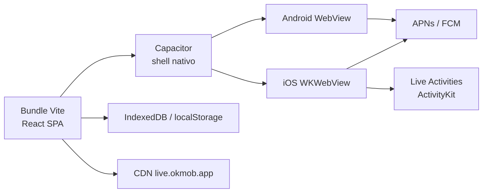

# 05 · App móvil

**Fecha de observación:** 21/10/2026 (UTC)
**Confianza:** A para fichas de tienda y artefactos del bundle; B para el comportamiento nativo inferido; D para todo lo que exigiría un dispositivo real.

---

## 1. Resumen

OKMob tiene una app móvil distribuida en App Store y Google Play, construida como **shell Capacitor** sobre el mismo bundle web. No es una app nativa pura: reutiliza la SPA, añade plugins nativos para push, Live Activities, estado de app y almacenamiento, y se apoya en la misma CDN.

Su ventaja frente a Stick Live no es técnica: es de **distribución y acabado móvil**. OKMob ya está en las tiendas, tiene Live Activities/Dynamic Island en iOS y una experiencia catalana pulida. Stick Live tiene una app Expo con paridad funcional en código, pero el release y las funciones de pantalla bloqueada siguen pendientes.

---

## 2. Distribución y hechos de tienda

| Plataforma | Versión | Valoración | Instalaciones | Actualización | Tamaño | Idiomas | Anuncios | Confianza |
|---|---|---|---|---:|---|---|---|---|
| iOS (App Store) | 1.5.22 | 29 valoraciones, 5,0 | — | Hace 1 día (21/10/2026) | 37,6 MB | ES + 2 | Sí | A |
| Android (Google Play) | 1.5.21 | 16 reseñas, 5,0 | 1K+ | 18/10/2026 | — | — | Sí | A |
| PWA | — | — | — | — | — | CA/ES/EN (aprox.) | — | A/B |

- Desarrollador iOS: **POL VALLS BALFAGON** (persona física, no una sociedad).
- Categoría: deportes.
- La ficha de iOS declara compatibilidad con iPhone/iPad y Live Activities en las notas de la versión 1.5.21.
- La ficha de Android muestra «1 mil+» instalaciones, versión 1.5.21 y actualización del 18/10/2026; no se verificó el número exacto de descargas. La descripción se presenta como bilingüe catalán/castellano, pero no se verificó el detalle de idiomas de la app.
- No se observó una versión de pago ni suscripción. «Sobre» declara que el producto se financia solo con anuncios y que no hay compras.

**Lectura:** OKMob ha superado la barrera de distribución, que es la que todavía tiene Stick Live. La app no necesita ser técnicamente superior para captar usuarios: estar en la tienda y en catalán ya es una ventaja.

---

## 3. Stack y arquitectura

Evidencia:

- `H.isNativePlatform()`, `Capacitor.getInfo()`, `appStateChange` en el bundle.
- `okmob-native-build` como marca de build.
- En nativo se **desregistra el service worker** y se limpian caches web; la app usa el almacenamiento del WebView/IndexedDB.
- Plugins inferidos: push, app state, Live Activities, haptics, share/browser, status bar. No se verificó la lista exacta.
- El bundle es el mismo que la web; no hay una capa de UI nativa completa.

**Consecuencia:** el coste de mantener dos plataformas es bajo, pero la app hereda los límites del WebView: arranque, memoria, gestos y rendimiento no son los de una app nativa pura. No se midió el impacto real.

---

## 4. Funciones nativas

### 4.1 Push

- FCM/APNs (CSP incluye `firebaseinstallations.googleapis.com` y `fcmregistrations.googleapis.com`).
- Tipos de aviso en el bitmask del bundle: `reminder`, `start`, `half`, `result`, `goal`, `blue`, `red`, `penalty`.
- Preferencias por equipo/tema (`teamTopicCategory`, `playerAlerts`).
- Marcas locales `okmob-push-marks` para deduplicar.
- `syncOutbox` para reintentar la sincronización de preferencias.
- El web no envía push con la pestaña cerrada (FAQ); la app nativa sí.

**No verificado:** entrega real de una notificación, latencia, comportamiento en modo ahorro de energía, tasa de apertura.

### 4.2 Live Activities y Dynamic Island

- Claves `okmob-la-*`: `okmob-la-auto`, `okmob-la-armed`, `okmob-la-synced`.
- La app puede mostrar el marcador, el reloj, las faltas y las superioridades en la pantalla bloqueada/Dynamic Island.
- Se activa/desactiva por partido; no se verificó el flujo exacto.
- Es una función diferencial frente a Stick Live, que aún no la tiene.

**Valor:** para un aficionado que sigue un partido mientras hace otra cosa, la Live Activity es más útil que una notificación puntual. Es una de las pocas funciones que justifican una app nativa frente a la PWA.

### 4.3 Offline y recuperación

- IndexedDB `keyval-store`; caches `okmob-crests-v1`; `okmob-cache-v1` en web.
- `okmob-dorsals-v1` cachea dorsales.
- `okmob-rulebook.v1` cachea el reglamento.
- `okmob-chunk-reload` recarga si un chunk falta tras un deploy.
- `okmob-boot-stuck` cuenta arranques bloqueados; tras 2, limpia IndexedDB, caches y service worker.
- Respuestas locales con `X-OKMob-Stale`, `X-OKMob-Fetched-At`, `X-OKMob-Local`.

**Lectura:** OKMob trata el arranque y la actualización como estados de producto, no como errores excepcionales. Es una buena práctica que Stick Live debería copiar en su app Expo.

### 4.4 Ubicación y proximidad

- `okmob-last-location`, `okmob-nearby-v1`.
- Flag `nearby: true`.
- La CSP permite geolocalización self.
- Probable uso: partidos/pabellones cercanos. No se verificó si la ubicación se envía al servidor o se queda en local.

**Privacidad:** no se observó una finalidad documentada en la ficha de tienda. Si Stick Live implementa proximidad, debe pedir permiso contextual, explicar la finalidad y no enviar coordenadas sin necesidad.

### 4.5 Anuncios y consentimiento

- AdMob en la app; AdSense en web.
- `noBypassOnDecline`: si el usuario rechaza la personalización, la app sigue funcionando con anuncios no personalizados.
- `assistantAds: true`: el asistente puede mostrar anuncios.
- No se verificó el flujo de consentimiento ni la integración con ATT (iOS).

### 4.6 Asistente

- Mismo clasificador local + fallback cloud que la web.
- Consentimiento `okmob-ai-consent`.
- Créditos/recompensas por anuncios (`/chat/credits`).
- Timeout 15 s y stream 45 s; un reintento.
- En offline, el clasificador local puede responder sin red.

---

## 5. UX móvil

Fortalezas observadas:

- Navegación inferior y safe areas.
- Tema claro/oscuro/automático.
- Tamaño de texto hasta 130 %.
- Viewport sin bloqueo de zoom; inputs a 16 px.
- Skeletons, pull-to-refresh, banner de offline y mensajes de error por categoría.
- Banner de instalación PWA y de actualización nativa.
- Live Activities y push como continuidad fuera de la app.
- Sin registro: se puede usar al instante.

Debilidades o riesgos:

- Es un WebView; la fluidez depende del bundle y del dispositivo.
- No hay cuenta: seguidos y preferencias no se sincronizan entre dispositivos.
- La FAQ declara que el push web con la pestaña cerrada no existe.
- La app depende de la misma CDN y del mismo worker que la web; un fallo de ingesta afecta a ambos.
- No se verificó la accesibilidad real con VoiceOver/TalkBack, ni el comportamiento con teclado externo, ni el modo de alto contraste.

---

## 6. Privacidad y permisos

| Permiso/dato | Uso observado/inferido | Confianza |
|---|---|---|
| Notificaciones | Push de goles, inicio, resultado, tarjetas | A |
| Ubicación | Partidos/pabellones cercanos (`okmob-nearby-v1`) | B |
| Identificador de publicidad | AdMob/AdSense | B |
| Consentimiento de IA | `okmob-ai-consent` | A |
| Fecha de nacimiento de jugadores | Visible en perfiles | A |

**Riesgo:** la fecha de nacimiento de jugadores es un dato personal que OKMob publica en la ficha. Es común en el deporte federado, pero debe tratarse con cuidado (minimización, acceso, finalidad). Stick Live ya tiene `birth_date` en `players`; debe revisar si lo expone y con qué base legal.

---

## 7. Rendimiento y estabilidad

Lo observado:

- 37,6 MB en iOS; el bundle web se cachea y se divide por rutas.
- Recuperación de chunks y de arranque bloqueado.
- Cache de escudos, dorsales y reglamento.
- Live Activities y push fuera de la app.

Lo **no** observado:

- Tiempo de arranque en frío.
- Uso de memoria.
- Consumo de batería.
- Latencia de push.
- Tasa de crashes.
- Comportamiento en redes lentas o offline real.
- Diferencia de rendimiento entre iOS y Android.

No se dispone de dispositivo/emulador en el entorno. Cualquier afirmación sobre rendimiento nativo sería especulativa.

---

## 8. Comparación con Stick Live

| Dimensión | OKMob | Stick Live | Lectura |
|---|---|---|---|
| Distribución | App Store + Google Play + PWA | Expo app con paridad en código; release pendiente según `docs/app.md` | OKMob lidera. |
| Stack | Capacitor + WebView | Expo SDK 57 / RN 0.86 / expo-router | Stick Live tiene una base más nativa y mantenible. |
| Idiomas | CA/ES/EN | ES/EN/PT/FR/IT; **sin CA** | OKMob lidera en Cataluña. |
| Live Activities | Sí (iOS) | No | OKMob lidera. |
| Push | FCM/APNs + temas | Push nativo + SSE | Paridad funcional; OKMob tiene más años de rodaje. |
| Offline | IndexedDB/caches + recuperación | Caché y SSE; revisar paridad | OKMob tiene más detalles de recuperación. |
| Observabilidad | Beacons de cliente; sin estado público | Sentry/PostHog; tests/CI | Stick Live lidera. |
| Modelo | Ads-only, sin cuenta | Auth, favoritos, premium | Stick Live tiene más recorrido de producto. |
| Release | En tiendas | Pendiente de EAS/store | OKMob lidera. |

### Qué copiar

- Live Activities/Dynamic Island para partidos seguidos.
- Recuperación de arranque y chunks.
- Cache de escudos/dorsales/reglamento.
- Push por equipo/tema con deduplicación.
- Calendario `.ics` y enlaces profundos.

### Qué no copiar

- Shell Capacitor si la app Expo ya funciona; no hay razón para cambiar.
- Modelo ads-only; Stick Live tiene premium.
- Almacenamiento solo local sin cuenta; Stick Live puede sincronizar.
- Publicación de fecha de nacimiento sin revisión de privacidad.

---

## 9. Recomendaciones específicas

1. **Publicar la app Expo** (P0/P1): completar `eas init`, token de Sentry, builds de producción, TestFlight/Play interno y ficha de tienda. La paridad ya está en código; el coste es operativo.
2. **Añadir catalán** a la app y a la web (P0): es la brecha más visible frente a OKMob en el mercado de FECAPA.
3. **Live Activities** (P1/P2): empezar por iOS con el partido seguido; después evaluar Android (notificación persistente).
4. **Deep links y push** (P1): enlaces `sticklive.eu/matches/...` que abran la app; push por equipo con preferencias.
5. **Recuperación de arranque/chunks** (P1): copiar el patrón `boot-stuck`/`chunk-reload`; es barato y evita reseñas de 1 estrella.
6. **Calendario `.ics`** (P1): endpoint y botón «suscriptar» en equipo/competición.
7. **ASO** (P1): ficha en catalán, capturas con el directo y la clasificación, palabras clave locales; no copiar la ficha de OKMob.

---

## 10. Límites de la evidencia

- No hay dispositivo/emulador: no se observó tráfico de la app, ni cold start, ni push real, ni Live Activities en funcionamiento.
- Las conclusiones nativas se basan en el bundle, las fichas de tienda y la documentación pública.
- No se verificó el estado actual de la app de Stick Live en tiendas; `docs/app.md` describe el código y los pasos de release, no el estado de distribución.
- No se auditó la privacidad real (trackers, ATT, retención) de OKMob.
