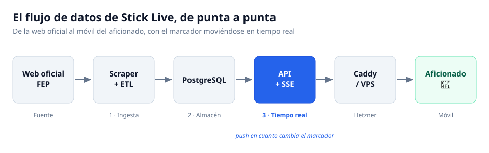
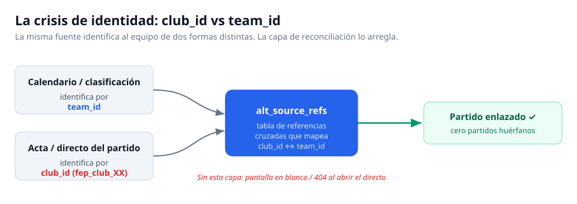

# Construí una plataforma de resultados en directo con IA sin ser ingeniero: el caso real de Stick Live

Un sábado por la tarde estaba siguiendo un partido de hockey sobre patines desde el móvil. La web oficial tardaba en cargar, tenía que refrescar la página constantemente y, al final, me costaba más seguir el marcador que el propio partido. Y pensé lo que piensa cualquiera que ha sufrido un producto malo: **esto debería ser mejor.**

La diferencia es que, esta vez, decidí dejar de quejarme y construirlo.

Soy Product Manager, no ingeniero de sistemas. Sé diseñar APIs, modelar funcionalmente un producto y montar tracking de eventos. Pero si me sientas delante de una configuración seria de Docker, una réplica de PostgreSQL o un canal de tiempo real, hasta hace unos meses te habría dicho que **no sabía ni por dónde empezar**.

Y aun así, hoy tengo en producción **[Stick Live](https://sticklive.eu)**: una plataforma de resultados en directo de hockey sobre patines que extrae los datos de las fuentes oficiales y los sirve en tiempo real al móvil de un aficionado mientras su equipo marca un gol. La construí yo solo, conversando con Claude, en **semana y media** y por **menos de 30 € al mes**.

Quédate con:

> **La IA ha cambiado la economía de *construir*, no la de *validar*. Hoy un perfil de producto puede levantar solo una infraestructura que hace tres años exigía un equipo. Pero no te quita la responsabilidad de decidir qué merece la pena hacer, ni la disciplina de empezar pequeño.**

## Números del proyecto

| Métrica | Valor |
|---|---|
| Tiempo de desarrollo | ~semana y media (≈2 h/día, más los fines de semana en directo) |
| Horas reales aproximadas | 35–40 |
| Archivos de código | 212 |
| Migraciones de base de datos | 27 |
| Commits | 97 |
| Conversaciones con Claude | 17 hilos |
| Coste de infraestructura | ~6 €/mes (VPS Hetzner) + ~6 €/año (dominio) |
| Coste de IA | 22 €/mes (plan de Claude) |
| Bugs críticos encontrados | 10 (auditoría) + 7 en el debut del directo |
| Cobertura | OK Liga + más de 50 equipos y competiciones seguidos |
| Usuarios registrados | 29 |
| Visitas acumuladas | 1.402 |
| Objetivo | Validar la hipótesis la próxima temporada |

Mira la fila del coste un segundo: **tener esto en producción me cuesta menos de 30 € al mes**. Hace tres años, una plataforma con scraping, base de datos, tiempo real y despliegue habría necesitado varios perfiles y un presupuesto.

> **Nota de honestidad, por delante de todo:** a día de hoy **la tracción sigue sin validar**. 29 usuarios y 1.402 visitas son experimentación, no validación. Esto es un hobby nacido de un dolor muy concreto, y la prueba de verdad llegará la próxima temporada.

Vamos a ver **por qué un PM se metió a construir algo que no sabía construir**, **por qué fui directo a producción sin validar**, **el sistema de trabajo con IA** que funcionó (con plantilla copiable), **la crisis técnica** que casi lo tira todo, **el día que vacié la base de datos** y **el mensaje** que diferencia esto de los mil artículos de vibe coding.

## El problema: seguir el hockey patines en directo era un suplicio

El hockey sobre patines es un deporte de **nicho con afición fiel y muy localizada**. Pero la experiencia digital para seguirlo es de otra época.

La web oficial funciona, pero hacer seguimiento de un partido **desde el móvil** —que es donde lo hace todo el mundo, en la grada o en el sofá— es incómodo. La usabilidad es pobre, el *UX writing* inexistente, navegar por una competición cuesta y visualmente no invita a quedarse. **No puedes seguir cómodamente tu liga o tu equipo favorito.** Te pasas el rato recargando para ver si el marcador se ha movido.

Lo viví yo como aficionado y lo contrasté con compañeros de hockey, que asentían. Y en este nicho —ya lo verás— **no hay atajo de validación barata**: el valor es el directo, y el directo hay que construirlo.

> [Captura sugerida: comparativa lado a lado de la ficha de partido en la web oficial vs. la ficha en directo de Stick Live en móvil. Vale más que mil párrafos sobre "usabilidad".]

## Por qué un PM se metió a construir algo que no sabía construir

Esta es la parte que de verdad importa, porque el protagonista no es la tecnología: soy yo decidiendo meterme en un charco que, sobre el papel, me venía grande.

**La primera chispa fue el dolor como usuario y como fan.** Estar pendiente de un partido de hockey y que la web no esté a la altura en el móvil. Ese cabreo concreto, repetido fin de semana tras fin de semana, es el verdadero origen de Stick Live. No nació de un *brainstorming* de oportunidades de mercado; nació de una frustración personal.

**La segunda chispa fue tecnológica, y es la que lo hizo posible.** Para alguien con mi formación, la barrera nunca había sido la lógica ni el diseño del producto: era la **sintaxis y la configuración del entorno**. Ese ha sido siempre mi muro de Berlín. Y en algún momento caí en que:

> **La programación moderna se parece cada vez más a la redacción y a la lógica abstracta, y cada vez menos a memorizar comandos.**

Y resulta que redactar con claridad y pensar en lógica abstracta es **exactamente** lo que hace un PM todo el día. El muro no había desaparecido, pero por primera vez tenía una grúa para saltarlo. Ahí entendí que podía hacerlo: no porque me hubiera convertido en ingeniero, sino porque la parte que me bloqueaba (la sintaxis) era justo la que la IA resolvía mejor, y la parte que de verdad decide (el criterio) seguía siendo mía.

## La decisión incómoda: producción seria sin validar

El manual de producto dice: si no has validado la demanda, **no construyas una arquitectura de producción**. Haz una landing falsa, un prototipo de fin de semana. Valida barato.

Yo hice lo contrario, y la razón es la **lección de producto número uno** del proyecto:

> **En este nicho, el valor *es* el directo. No puedes validar si a la gente le interesa una plataforma de resultados en vivo con un prototipo que se actualiza a mano cada media hora, ni con una landing que dice "pronto verás los resultados aquí".**

El producto solo es el producto cuando **el marcador se mueve solo, en tiempo real, fiable, en el móvil**. Lo demás es una maqueta que no prueba nada. A eso se sumaron dos motivos honestos: **quería aprender vibe coding de verdad** y **demostrarme que podía levantar una infraestructura robusta yo solo**. La barrera técnica había bajado lo suficiente como para que el coste de intentarlo fuera asumible.

## La arquitectura, en un vistazo

No te voy a aburrir con la fontanería. Lo esencial cabe en un dibujo:



Un **scraper** entra en la web de la federación y extrae el calendario, las clasificaciones y, durante los partidos, el acta en directo. Un proceso **ETL** limpia y normaliza esos datos (que vienen de scripts antiguos y poco consistentes) y los guarda ordenados en una base de datos. Una **API** lee de ahí y, para el directo, mantiene una conexión abierta que **empuja cada cambio del marcador al navegador del usuario** sin que él tenga que recargar nada.

Todo corre en **un único servidor pequeño de Hetzner**, detrás de un servidor web que sirve la página. Y lo relevante para ti, que no eres ingeniero: cada una de esas piezas —scraping, normalización de datos, base de datos, tiempo real, despliegue— es una **especialidad distinta**, y tradicionalmente la habría tocado un perfil distinto. Aquí las he ido montando yo, una a una, decidiendo el qué y dejando que la IA resolviera el cómo.

La clave para que eso no acabara en un caos fue **el sistema de trabajo**. Vamos a ello, que es lo más útil del artículo.

## Cómo trabajé con Claude: el sistema que de verdad funcionó

Si te llevas una sola cosa práctica, que sea esta sección. Tres prácticas, en orden de impacto.

**1. Un documento de arquitectura como única fuente de la verdad.** Lo primero al arrancar fue crear un fichero donde quedaron grabadas a fuego las convenciones del proyecto: cómo se organizan las carpetas, cómo se nombran las cosas, qué decisiones técnicas son innegociables. Parece burocracia, pero **es lo que evita que el proyecto se descarrile**: las IAs, en sesiones largas, se despistan, olvidan decisiones y reinventan lo ya hecho. Ese documento es la **memoria compartida**, y de él la IA ha ido tirando durante semanas sin perder el hilo.

**2. Prompts por rol + tarea acotada + "documenta todo".** No traté a la IA como un chat genérico. Cada paso era un prompt en el que actuaba como un **rol concreto** (el arquitecto de software, el especialista en UX, el experto en bases de datos), con un detalle muy ajustado. Definir el rol **eleva la calidad y reduce las alucinaciones**. Aquí tienes una plantilla real y copiable:

```
[ROL]
Actúa como ingeniero de datos senior especializado en scraping y
pipelines de datos robustos. Trabajas conmigo en pair programming:
yo pongo el criterio de producto, tú la ejecución.

[CONTEXTO — léelo antes de tocar nada]
Lee el documento de arquitectura. Es la fuente de la verdad.
Respeta sus convenciones sin excepción.

[TAREA]
Crea el scraper de la OK Liga que ingiere el calendario. Por ahora
SOLO OK Liga, una temporada. No amplíes a otras ligas aunque puedas.

[OJO / RIESGOS CONOCIDOS]
La fuente del directo y la del calendario identifican a los equipos de
forma distinta. NO asumas que el identificador es el mismo en las dos.

[CRITERIOS DE ACEPTACIÓN]
1. Cada partido del calendario queda enlazable con su directo.
2. Re-ejecutar el proceso no duplica registros.
3. Logs claros de qué se insertó / actualizó / omitió.
4. Si una fuente cambia de formato, falla con un error explícito,
   nunca en silencio.

[CIERRE]
Documenta cualquier decisión nueva. Cuando termines, explícame en
3 líneas qué has hecho y qué debería probar yo.
```

Fíjate en dos detalles que me ahorraron disgustos: **"falla con un error explícito, no en silencio"** y **"explícame qué debería probar yo"**, que convierte cada entrega en una mini-sesión de QA.

**3. Pedir poco, iterar mucho.** La gran trampa del vibe coding es que **es demasiado fácil pedir cosas enormes**. Como la IA te las da, te vienes arriba y le encargas la funcionalidad completa de golpe. Y quiero ser claro:

> **Los bugs no venían tanto de la IA como de mi ambición de hacerlo todo ya.** Cuando le daba los detalles ajustados y avanzaba paso a paso, funcionaba bastante bien.

## La crisis: el día que todos los partidos quedaron huérfanos

Este fue **el momento de pánico técnico** del proyecto, y el mejor ejemplo de cómo trabajan juntos un humano con criterio y una IA con fuerza de ejecución.

Tras un vaciado y repoblado de la base de datos, el sistema **colapsó visualmente**. En la home salían los partidos de la jornada, pero al hacer clic en uno en vivo, la pantalla se quedaba **en blanco o daba error**. Los partidos quedaban **huérfanos**, sin enlazar con su directo.

La causa fue un clásico error de asunciones: yo había dado por hecho que **la web de la federación identificaba a cada equipo con un único código** en toda su web. No era así. El calendario usaba un identificador y el acta del directo usaba otro distinto. El sistema buscaba el directo con el código equivocado y no encontraba nada.



Lo interesante es **cómo se depuró**, porque ahí está el método. Fue **pair programming puro**. Yo no escribí el arreglo. Lo que hice fue **señalar el error con todo el detalle posible**: le pegaba a la IA los mensajes de error, dónde sospechaba que estaba el problema, qué había probado. Pero **fue la IA la que diagnosticó y arregló**. Yo ponía el dedo en la llaga con precisión; ella ejecutaba. La solución fue una **capa intermedia que reconcilia los dos identificadores**.

> **Nunca asumas que un identificador de una fuente externa es universal.** Lo que no controlas es inconsistente por naturaleza, y tu modelo necesita una capa que lo reconcilie.

## El día que vacié la base de datos

Te lo cuento porque es el momento del que más se aprende, y porque seguramente no sentí lo que esperas.

Vengo de la fase ambiciosa: al principio quise meterlo todo, **cien ligas y todas las temporadas de golpe**. Y el histórico **no se sostenía**: datos sin normalizar, inconsistentes, imposibles de verificar. Ahí sí tuve mi momento de mayor duda. No pensé en abandonar, pero sí me pregunté con frío si **la arquitectura y el diseño estaban mal planteados** y si tocaba hacer cambios drásticos.

Aquí es donde la **mentalidad de PM** salvó el proyecto: aislar el problema y mirar el tablero con realismo. En lugar de tirar abajo la arquitectura, decidí ir poco a poco con el volcado del histórico. Y, de paso, **vacié la base de datos de producción y la repoblé solo con la OK Liga.** Sin backup. Perdí un histórico que iba de 1999 a 2026.

¿Y qué sentí? Sorprendentemente poco. **No había usuarios; era yo experimentando.** Así que no fue un drama operativo: de hecho, aproveché para hacer mejoras. Lo único que dolió fue, a nivel estratégico, perder ese histórico como **activo diferencial**. Hubo un pequeño luto. Pero pasado el luto te das cuenta de que **el motor del directo, el diseño de la consola del anotador y la lógica multiidioma seguían ahí. El código y el aprendizaje no se habían borrado.**

> **La lección que sí me llevo para el futuro:** lo que hoy fue inofensivo (no había nadie usando la app) mañana será imperdonable. **Backups automáticos y verificados antes de cualquier operación destructiva**, en cuanto haya un solo usuario de verdad.

## Producto y métricas: PostHog, el aha moment y el efecto laboratorio

Para la analítica elegí **PostHog**, con una decisión consciente: **apagar el autocapture**. No quería almacenar basura ni inflar costes; prefiero medir poco pero que demuestre **intención real**. Hoy mido la interacción con el directo (qué partidos y pestañas se consultan), la configuración de preferencias (clubes y competiciones que sigue la gente) y la **fiabilidad del tiempo real** (si la conexión se cae y se reconecta). Este último bloque es oro: mide lo único que de verdad importa.

Pienso el embudo en clave **AARRR**, y el **aha moment** lo tengo clarísimo: **recibir la primera notificación push de un gol en tiempo real**. Ese es el momento en que el usuario entiende para qué sirve Stick Live.

Pero hay que confesar algo que casi nadie dice: **el efecto laboratorio**. A veces priorizo algo —una animación cuando cambia el marcador, refactorizar una parte— porque es **el reto técnico que me apetece esa semana**. ¿Es óptimo según el manual? No. ¿Es vital en un proyecto unipersonal? Sí:

> **Mantener el momentum del que construye es lo que mantiene vivo el producto.** Un proyecto de una sola persona muere el día que deja de ser divertido construirlo.

## La auditoría que me bajó los humos: de 5,5 a ~8

Con el producto ya en producción hice algo que recomiendo a cualquiera que construya con IA: **le pedí a la IA que auditara su propio trabajo**, como si un equipo fuera a heredar el proyecto y mantenerlo tres años.

El veredicto inicial: **5,5 sobre 10**. Duele, pero es justo lo que necesitaba. Encontró cosas que yo no veía: un agujero de seguridad serio en el acceso por enlace mágico, ausencia de límites de peticiones en la API, un sistema de tiempo real que **no aguantaría audiencia real**, cero tests automáticos y ningún control previo al despliegue. La fui aplicando poco a poco, cerré **todos los hallazgos graves**, y la nota subió a un **~8**.

> **Nota:** el valor no estuvo en el número, sino en convertir una lista de vergüenzas en un **plan priorizado**. Si construyes con IA, esta es probablemente la práctica de QA con más retorno: pídele que se ponga el sombrero de ingeniero senior y sea despiadada contigo.

## Errores y lecciones

Más allá del histórico, dos trampas en las que caí y que quiero ahorrarte:

**Desplegué el directo sin probarlo contra un partido real.** El flujo estrella salió con poca prueba, y la primera jornada en vivo destapó **siete bugs de golpe** (eventos en el lado equivocado, faltas mal contadas, partidos duplicados por un lío de zona horaria). El bug de las horas lo cacé con un método artesanal pero infalible: **comparar mi app contra la fuente oficial en tiempo real**. Lección: **el camino crítico se valida de punta a punta con un caso real antes de producción**.

**Metí los tests demasiado tarde.** Y esto no es teoría: **desde que metí los tests, el proyecto ha funcionado prácticamente sin errores**. Si empezara hoy, los pondría desde el día uno, junto con un **"Nano-MVP" del directo**: antes de construir ligas, perfiles y clasificaciones, validar una sola cosa —¿puedo pintar un marcador que se actualice solo, en tiempo real, en las peores condiciones de conexión de una grada? Si eso no aguanta, lo demás sobra.

## Estado actual y próximos pasos

Stick Live está **en producción, funcional**, con la OK Liga en directo, fichas con goles y actas, clasificaciones, favoritos y notificaciones. Técnicamente lo traté en serio desde el primer día; **como negocio sigue siendo un hobby sin validar**, y soy honesto con ello.


El siguiente paso inmediato es **mejorar las notificaciones del directo** (la palanca de retención más barata). Después, una **app nativa**, primero Android. Y, con cuidado, **ampliar competiciones una a una**. Pero la gran cita es la próxima temporada: ahí volcaré la energía en **adquisición de usuarios** y, por fin, pondré la hipótesis a prueba de verdad.

## ¿Lo volvería a hacer?

Es la pregunta que importa, y como PM no me la voy a saltar. Porque la pregunta interesante ya no es *"¿se puede construir?"* —eso ya sabemos que sí—, sino **"¿compensa hacerlo?"**. Mi respuesta tiene tres capas:

**Como negocio, todavía no lo sé.** Con 29 usuarios y la temporada terminada, sería mentir decir otra cosa. La respuesta llega el año que viene, cuando vuelque energía en adquisición y la hipótesis se enfrente a usuarios de verdad.

**Como aprendizaje, sí, sin dudarlo.** He tocado con las manos scraping, ETL, bases de datos, tiempo real y despliegue. Ya no son cajas negras que delego: son cosas que entiendo, que sé pedir y que sé evaluar. Para un PM, eso cambia cómo hablo con ingeniería para siempre.

**Como experimento sobre lo que hoy permite la IA, absolutamente sí.** Tenía una hipótesis sobre la nueva economía de construir y ahora tengo una prueba tangible en producción, con sus costes, sus números y sus cicatrices. Eso vale más que diez artículos teóricos leídos.

Si tu proyecto solo tiene sentido como negocio inmediato, piénsatelo. Si además te sirve como aprendizaje y como apuesta sobre hacia dónde va esto, el cálculo cambia mucho.

## Resumen rápido

- **La IA cambia la economía de construir, no la de validar.** Hoy un perfil de producto puede levantar solo lo que antes pedía un equipo; lo que no cambia es la disciplina de producto.
- **En algunos nichos no hay validación barata:** si el valor es el directo, tienes que construir el directo.
- **Pon tú el criterio, deja la ejecución a la IA.** Señala los errores con precisión y deja que arregle.
- **Documento de arquitectura desde el día uno**, prompts por rol con criterios de aceptación, y **pide poco e itera**: la ambición desbocada es la principal fuente de bugs, no la IA.
- **Tests desde el principio** y **backups antes de cualquier operación destructiva** en cuanto haya un usuario.
- **Audita tu propio trabajo con la IA.** Un 5,5 que se convierte en un plan es el mejor regalo que puedes hacerte.

## El criterio sigue siendo humano

Hace tres años, este proyecto habría necesitado varios perfiles distintos: backend, frontend, DevOps, scraping y producto. Hoy lo ha construido **una sola persona**, en semana y media, por menos de 30 € al mes.

Eso **no significa que cualquiera pueda hacerlo.** Significa que la ventaja competitiva ya no está en escribir código. Está en **saber qué construir, cómo validarlo y cuándo parar.**

La IA me dio capacidad de ejecución. **El criterio sigue siendo humano.**

---

*Este es el primer caso de una serie: productos reales hechos con IA, contados con los errores dentro. Si te interesa la parte de analítica que hay detrás de decisiones como el aha moment, lo desarrollo en mis artículos sobre [analítica de producto](https://angelrobledano.com/analitica-de-producto/). Y si tienes un proyecto de nicho parado porque crees que no tienes el perfil técnico para construirlo, quizá ya no sea verdad: [escríbeme](https://angelrobledano.com/contacto/) y lo comentamos.*
